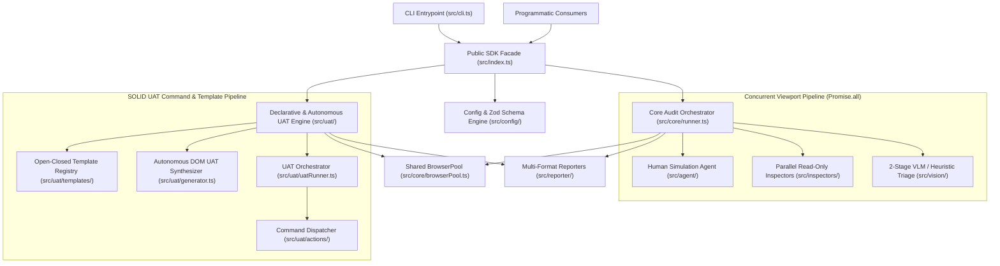

# 🏗️ BetterFront System Architecture & SOLID Design Patterns

BetterFront is architected as a **modular, strictly-typed TypeScript ESM framework** adhering to **SOLID** principles, **Clean Architecture** domain separation, and **high-concurrency non-blocking execution**.

---

## 🧭 High-Level System Architecture

---

## 🧩 Domain Module Boundaries (`src/`)

Every file in `src/` has a single, well-defined responsibility:

### 1. Domain Type System (`src/types/`)
Decomposed by domain so modules only depend on the interfaces they actually use (**Interface Segregation Principle**):
- `src/types/defects.ts`: Geometry (`Rect`), visual anomalies (`VisualDefect`), Core Web Vitals (`CoreWebVitalsMetrics`), accessibility (`A11yViolation`, `TouchTargetDefect`), and console/network telemetry.
- `src/types/config.ts`: `AnomalyToggles`, `ViewportDefinition`, `HumanAgentConfig`, and `BetterFrontConfig`.
- `src/types/reporting.ts`: `ViewportAuditResult`, `HealthScoreBreakdown`, and `AuditRunSummary`.
- `src/types/uat.ts`: All 38 `UatActionType` literals, `UatStep`, `UatScenario`, `UatRunResult`, `UatSuiteResult`, and `UatWorkflowTemplateId`.
- `src/types/index.ts`: Barrel export for external SDK consumers.

### 2. Core Browser & Recording Infrastructure (`src/core/`)
- `src/core/browserPool.ts`: Manages reusable Playwright `Browser` instances (`chromium`, `webkit`, `firefox`) and creates isolated `BrowserContext` sessions with automatic console error, uncaught exception, and HTTP 4xx/5xx network telemetry interception. Supports Dependency Injection into `runUat`, `runAutoUat`, and `runUatSuite`.
- `src/core/captureRecorder.ts`: Annotates DOM anomalies with visual bounding boxes and captures forensic screenshots, 60fps `.webm` videos, and Playwright `.zip` traces.
- `src/core/runner.ts`: Multi-viewport concurrent audit orchestrator.

### 3. Physics-Based Human Agent (`src/agent/`)
- `src/agent/kinematics.ts`: Cubic Bézier mouse trajectory generator with Fitts's Law velocity profiling (`moveMouseHumanLike`, `clickHumanLike`).
- `src/agent/typist.ts`: Human keystroke cadence simulator with realistic burst rhythm and optional typo/backspace recovery.
- `src/agent/scroller.ts`: Momentum-based wheel scrolling with reading pauses.
- `src/agent/formFiller.ts`: Context-aware synthetic data generator powered by `@faker-js/faker`.
- `src/agent/crawler.ts`: Autonomous state-exploring interaction agent supporting 4 personas (`curious-user`, `chaos-monkey`, `impatient-mobile`, `keyboard-only`).

### 4. Mathematical Layout, Accessibility & Performance Inspectors (`src/inspectors/`)
- `src/inspectors/layout/`:
  - `textCollision.ts`: `Range.getClientRects()` AABB text-on-text collision detector with Stacking Context verification.
  - `horizontalBleed.ts`: Mobile sideways overflow & `100vw` bleed detector.
  - `containerClipping.ts`: `overflow: hidden | clip` text descender & box starvation detector.
  - `interactiveOcclusion.ts`: `document.elementFromPoint(cx, cy)` z-index hit-target occlusion inspector.
  - `unsizedMedia.ts`: Unconstrained ``/`<video>`/ `<iframe>` CLS-risk detector.
  - `breakpointSweeper.ts`: Continuous viewport width sweeper (`320px` → `1440px`).
- `src/inspectors/a11y/`:
  - `axeRunner.ts`: WCAG 2.2 AA `axe-core` audit integration.
  - `colorContrast.ts`: Foreground/background luminance contrast ratio calculator.
  - `touchTargets.ts`: Mobile/Desktop minimum hit-target size verifier (`44x44px`).
  - `textZoom.ts`: 200% browser font-scale resilience stress test.
- `src/inspectors/perf/`:
  - `clsObserver.ts`: In-browser `PerformanceObserver` layout-shift session-window tracker with DOM node attribution.
  - `lighthouseRunner.ts`: Programmatic Lighthouse runner.
- `src/inspectors/network/`:
  - `linkChecker.ts`: Empty `href` and broken `#anchor` target inspector.

### 5. Modular UAT Workflow Engine (`src/uat/`)
Designed around **Single Responsibility**, **Open-Closed**, and **Command/Strategy** patterns:
- `src/uat/interpolation.ts`: Pure functions for `{{VARIABLE}}` template interpolation and URL resolution.
- `src/uat/selectorResolver.ts`: Resilient primary + `fallbackSelectors` DOM resolution, conditional `ifVisible` evaluation, and viewport filtering.
- `src/uat/actions/`:
  - `context.ts`: `UatActionExecutionContext` dependency inversion contract.
  - `navigationAndStateActions.ts`: Handlers for `GOTO`, `RELOAD`, `WAIT`, `WAIT_FOR`, `WAIT_FOR_NAV`, `SET_VIEWPORT`, `SET_STORAGE`, `ASSERT_STORAGE`, `SCREENSHOT`.
  - `interactionActions.ts`: Handlers for `CLICK`, `DOUBLE_CLICK`, `HOVER`, `TYPE`, `CLEAR`, `PRESS_KEY`, `SELECT`, `CHECK`, `UNCHECK`, `SCROLL`, `SCROLL_TO`, `FILL_FORM`, `EXECUTE_SCRIPT`.
  - `assertionActions.ts`: Handlers for all 20 DOM, CSS, accessibility, network, and visual-invariant assertions (with concurrent `Promise.all` execution in `ASSERT_ALL_INVARIANTS`).
  - `index.ts`: Central `dispatchUatStepAction` Command dispatcher.
- `src/uat/templates/`:
  - `types.ts`: `UatWorkflowTemplateMetadata`.
  - `coreTemplates.ts`: Core smoke, responsive matrix, accessibility, and visual regression templates.
  - `domainVariants.ts`: Pre-built platform workflows for **Dreamblu (`rpg-game-hud`)**, **Shopee (`shopee-marketplace`)**, **Tokopedia (`tokopedia-commerce`)**, **YouTube (`youtube-media-streaming`)**, and **Google (`google-search-portal`)**.
  - `workflowTemplates.ts`: Form chaos, auth session, e-commerce checkout, navigation/modals, and CRUD dashboard workflows.
  - `registry.ts`: Open-Closed template catalog exposing `registerUatTemplate()` so external plugins and users can register custom workflow templates at runtime without modifying library source code.
- `src/uat/generator.ts`: Zero-config live DOM crawler that synthesizes executable `UatScenario` definitions automatically.
- `src/uat/validator.ts`: Pre-flight schema & action validator with Levenshtein `"Did you mean?"` suggestions.

### 6. Multi-Format Reporting Suite (`src/reporter/`)
- `src/reporter/scoring.ts`: Objective 0–100 Health Index & hard-blocker quality gate calculator.
- `src/reporter/html.ts`: Interactive dark-mode Audit HTML dashboard generator.
- `src/reporter/uatHtmlReport.ts`: Interactive UAT step-by-step HTML report generator.
- `src/reporter/sarifExporter.ts`: GitHub Code Scanning SARIF 2.1.0 exporter.
- `src/reporter/junitExporter.ts`: CI/CD JUnit XML test suite exporter.
- `src/reporter/markdownExporter.ts`: GitHub Pull Request summary Markdown generator.
- `src/reporter/json.ts`: JSON summary serializer & barrel re-exporter.

---

## ⚡ Key Performance Optimizations

1. **Concurrent Read-Only DOM Inspection (`Promise.all`)**: Inside `src/core/runner.ts` and `src/uat/actions/assertionActions.ts`, all read-only DOM geometry, accessibility, and link inspectors execute concurrently in a single parallel batch over the settled DOM state.
2. **Parallel Multi-Viewport Execution**: Both `audit()` and `runUat()` execute target viewports (`desktop_fhd`, `tablet_portrait`, `mobile_standard`) concurrently in isolated `BrowserContext` sessions sharing a single browser process.
3. **Reusable `BrowserPool` Injection**: Suites and multi-scenario runners inject a warm `BrowserPool` across scenarios, eliminating repeated Chromium process startup overhead.
4. **Redundant Navigation Elimination**: `UatRunner` automatically detects when Step 1 is a `GOTO` matching `scenario.startUrl` and avoids double initial navigation.
