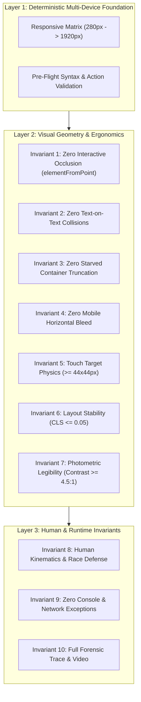

# Gold-Standard Frontend UAT & Defect Invariant Specification
## Deep Research, Architectural Principles, and Prevention Catalog

---

### Executive Overview: The Definition of "Gold Industry Standard" UAT

In top-tier engineering organizations (Google, Apple, Netflix, Stripe, Airbnb, Epic Games, HoYoverse), frontend testing is fundamentally separated from basic functional unit tests or naive Cypress/Playwright scripts.

A basic test checks:
> *"Does the `<button id="checkout">` exist in the DOM? Yes. Click it. Does the API return 200? Yes. Test passed."*

A **Gold Industry Standard UAT Engine** asks:
1. **Physical Legibility & Reachability**: Was that button physically clickable by a human, or was it occluded by a sticky topbar or an un-dismissed modal backdrop?
2. **Visual Integrity**: Did clicking that button trigger a text collision, container starvation, or a Cumulative Layout Shift (CLS) that caused the user to tap the wrong element?
3. **Multi-Viewport Invariant**: Does this exact interaction work with 0px horizontal sideways wobble across the entire viewport spectrum—from a 280px Galaxy Fold cover screen to a 1366px laptop to a 4K desktop monitor?
4. **Ergonomic Safety**: Does the button meet the Apple HIG / WCAG 44x44px physical touch target requirement, or does it cause fat-finger mis-taps on mobile?
5. **Runtime Cleanliness**: Did any silent unhandled JavaScript exceptions or Promise rejections fire in the background during this interaction?
6. **Forensic Reproducibility**: If an assertion fails, is there an instantaneous high-resolution snapshot with the failing DOM node highlighted in red, accompanied by a full-motion WebM video and scrubbable Playwright trace?

This document defines the **10 Invariant Quality Pillars** of Gold Industry Standard UAT, details the **12 Most Lethal Frontend Mistakes**, and specifies how BetterFront provides developers with **100% confidence** before shipping to production.

---

### Part 1: The 10 Invariant Quality Pillars of Gold-Standard UAT



#### Invariant 1: Dual-State Legibility & Hit-Testing (Zero Interactive Occlusion)
- **The Principle**: Element visibility in the DOM (`display !== none`, `visibility !== hidden`) does **not** guarantee user interactability.
- **The Invariant**: For every interactive target $E$, the hit-test coordinate $(c_x, c_y)$ evaluated via `document.elementFromPoint(c_x, c_y)` MUST resolve to $E$ or a descendant of $E$. If resolved to an unrelated layer with `pointer-events !== none`, the interaction is BLOCKED.

#### Invariant 2: Mathematical Visual Stability (Zero Text Collisions)
- **The Principle**: Text readability is inviolable. No two rendered text bounding boxes may overlap in 2D Euclidean space.
- **The Invariant**: Given two text ranges $R_A$ and $R_B$ belonging to non-nested DOM elements:
  $$\text{Overlap}_X = \max(0, \min(R_A.\text{right}, R_B.\text{right}) - \max(R_A.\text{left}, R_B.\text{left}))$$
  $$\text{Overlap}_Y = \max(0, \min(R_A.\text{bottom}, R_B.\text{bottom}) - \max(R_A.\text{top}, R_B.\text{top}))$$
  If $\text{Overlap}_X \ge 3\text{px}$ and $\text{Overlap}_Y \ge 3\text{px}$ and $\text{Area} \ge 12\text{px}^2$, a `TEXT_ON_TEXT_COLLISION` defect is flagged.

#### Invariant 3: Container Capacity & Unamputated Data (Zero Starved Containers)
- **The Principle**: Data must not be amputated by careless layout constraints.
- **The Invariant**: Any container with `overflow: hidden` or `overflow: clip` must satisfy:
  $$\text{scrollHeight} \le \text{clientHeight} + 4\text{px} \quad \text{and} \quad \text{scrollWidth} \le \text{clientWidth} + 4\text{px}$$
  Critical entities (prices, primary CTA buttons, status labels) MUST NEVER be truncated with an ellipsis (`text-overflow: ellipsis`) that conceals critical numbers or words.

#### Invariant 4: Mobile Viewport Fluidity (Zero Sideways Wobble)
- **The Principle**: A mobile application must feel native. Sideways wobbling when a user attempts to scroll vertically is the hallmark of substandard frontend engineering.
- **The Invariant**: For all mobile viewports ($W < 768\text{px}$):
  $$\text{document.documentElement.scrollWidth} \equiv \text{window.innerWidth}$$
  No element bounding box may have $\text{right} > \text{clientWidth} + 2\text{px}$.

#### Invariant 5: Ergonomic Touch Physics (WCAG 2.5.5 / 2.5.8 & Apple HIG)
- **The Principle**: Humans interact with glass screens using fingers, not pixel-accurate mice.
- **The Invariant**: Primary interactive controls (buttons, navigation tabs, dropdown triggers, checkboxes) must measure at least **$44 \times 44\text{px}$** (Apple HIG) or at least **$24 \times 24\text{px}$ with $\ge 8\text{px}$ spacing** (WCAG 2.5.8 Level AA).

#### Invariant 6: Cumulative Layout Stability (Zero Visual Jumps)
- **The Principle**: Elements must not move under the user's cursor while they are trying to interact with the interface.
- **The Invariant**: Unprovoked layout shifts must not exceed $\text{CLS} \le 0.05$. All ``, `<video>`, and dynamic banner containers must possess explicit aspect ratios or reserved min-height placeholders prior to asset load.

#### Invariant 7: Photometric Legibility & Zoom Resilience (WCAG 1.4.3 / 1.4.4)
- **The Principle**: Interfaces must remain readable under dynamic lighting, OLED glare, and accessibility zoom.
- **The Invariant**: Text-to-background contrast ratio must satisfy:
  $$\text{Ratio} = \frac{L_1 + 0.05}{L_2 + 0.05} \ge 4.5:1 \quad (\text{or } 3.0:1 \text{ for text } \ge 18\text{pt})$$
  Furthermore, scaling font size to 200% must not cause overlapping text or broken containers.

#### Invariant 8: Human-Grade Kinematics & Race Condition Defense
- **The Principle**: Instantaneous teleporting clicks fail to reveal race conditions, focus transitions, and CSS hover glitches.
- **The Invariant**: UAT must simulate natural Bézier mouse curves, realistic typing cadence (50–120ms with occasional pauses), and test rapid double-clicks to ensure buttons properly disable/debounce during async requests.

#### Invariant 9: Runtime Hygiene & Silent Exception Zero-Tolerance
- **The Principle**: A page that looks fine visually but is throwing JavaScript errors in the background is a broken page.
- **The Invariant**: Zero unhandled `window.onerror` exceptions, zero `unhandledrejection` Promise errors, zero 4xx/5xx network asset failures, and zero broken links (`href="#"` or dead anchor targets).

#### Invariant 10: Forensic Reproducibility
- **The Principle**: A failed test without forensic evidence wastes hours of engineering triage.
- **The Invariant**: Every test failure must automatically:
  1. Highlight the failing DOM element on the live screen with a 4px red bounding box and glow.
  2. Save a high-resolution PNG failure snapshot.
  3. Flush a full-motion WebM video of the execution up to that point.
  4. Save an interactive Playwright trace archive (`.zip`).
  5. Print clickable terminal links (`file:///...`) for immediate 1-click inspection in the developer's IDE.

---

### Part 2: The 12 Lethal Common Frontend Mistakes Catalog

Below is an exhaustive analysis of the 12 most frequent frontend defects that slip into production, complete with root cause mechanics and code examples (Bad vs. Gold Standard).

---

#### Defect 1: The "Ghost Element" / Sticky Header Occlusion (Z-Index War)

- **The Symptom**: A user scrolls down on mobile or laptop and taps a form input or "Submit" button, but nothing happens—or the top navigation link is clicked instead.
- **Root Cause**: A sticky or fixed topbar (`position: sticky; top: 0; z-index: 1000;`) floats over page content. When the user scrolls, elements scroll underneath the header. Because the header has a higher stacking context, it captures all pointer events.
- **Visual Impact**: Form cannot be submitted; users abandon carts; automated basic tests pass because the button is present in the DOM (`ASSERT_VISIBLE` passes!), but real users cannot touch it.

```html
<!-- ❌ BAD: Sticky header without content offset or scroll-margin -->
<header style="position: fixed; top: 0; width: 100%; height: 70px; z-index: 9999;">
  <nav>Navigation Links</nav>
</header>
<main>
  <!-- Form input scrolls directly underneath fixed header and becomes unreachable! -->
  <input type="text" id="username" placeholder="Username">
</main>
```

```html
<!-- ✅ GOLD STANDARD: Proper padding clearance & scroll-margin-top -->
<header style="position: sticky; top: 0; width: 100%; height: 70px; z-index: 50;">
  <nav>Navigation Links</nav>
</header>
<main style="padding-top: 16px;">
  <!-- scroll-margin-top ensures focused/scrolled elements clear sticky header -->
  <input type="text" id="username" placeholder="Username" style="scroll-margin-top: 90px;">
</main>
```

- **BetterFront Prevention**:
  - `ASSERT_UNOCCLUDED` UAT step action tests `document.elementFromPoint(centerX, centerY)`. If the hit element is `.site-topbar`, it fails immediately and points out the occluding element and its z-index!
  - `detectInteractiveOcclusion` audits all buttons and inputs across the entire page.

---

#### Defect 2: The "Starved Container" & Premature Ellipsis Trap

- **The Symptom**: A button says `"Con..."` instead of `"Confirm"`, or an account balance shows `"$10,..."` instead of `"$10,000,000"`.
- **Root Cause**: A developer placed a fixed height (`height: 32px`) or fixed width (`width: 80px`) on a container combined with `overflow: hidden; text-overflow: ellipsis; white-space: nowrap;`. On different screen sizes or localized languages (German, French, Japanese), the content length expands and is amputated.
- **Visual Impact**: Critical pricing, currency HUDs, and actionable button text are unreadable.

```css
/* ❌ BAD: Hardcoded dimensions starving content */
.hud-currency-badge {
  width: 90px;
  height: 24px;
  overflow: hidden;
  text-overflow: ellipsis; /* Hides $10,000,000 as $10,... */
  white-space: nowrap;
}
```

```css
/* ✅ GOLD STANDARD: Intrinsic sizing with min-width and flex alignment */
.hud-currency-badge {
  min-width: 90px;
  width: fit-content;
  min-height: 28px;
  padding: 4px 12px;
  display: inline-flex;
  align-items: center;
  white-space: nowrap;
}
```

- **BetterFront Prevention**:
  - `ASSERT_NO_CLIPPING` verifies that `scrollWidth <= clientWidth` and `scrollHeight <= clientHeight`.
  - `detectContainerClipping` checks for vertical and horizontal starvation across all elements on the page.

---

#### Defect 3: The "Mobile Sideways Wobble" (Horizontal Scroll Bleed)

- **The Symptom**: On an iPhone or Android device, the user tries to scroll down, but the page moves diagonally or slides horizontally to reveal an ugly white strip on the right.
- **Root Cause**: An element has an explicit pixel width wider than the screen (e.g. `width: 500px` on a 390px iPhone), an unconstrained image (`img` lacking `max-width: 100%`), negative margins exceeding container padding (`margin-left: -24px`), or using `width: 100vw` which includes desktop scrollbar widths.
- **Visual Impact**: Destroys mobile user experience; feels broken and cheap.

```css
/* ❌ BAD: 100vw or fixed width causing sideways overflow */
.promo-card {
  width: 100vw; /* In desktop Chrome, 100vw includes scrollbar -> causes horizontal scrollbar! */
}
.hero-banner img {
  width: 450px; /* On 390px iPhone -> 60px horizontal bleed! */
}
```

```css
/* ✅ GOLD STANDARD: Viewport containment & responsive media */
body {
  overflow-x: clip; /* Modern clean containment without scrollbar lock */
}
.promo-card {
  width: 100%;
  max-width: 100%;
}
.hero-banner img {
  max-width: 100%;
  height: auto;
  object-fit: cover;
}
```

- **BetterFront Prevention**:
  - `ASSERT_NO_BLEED` UAT action checks for element bleed on mobile viewports.
  - `detectHorizontalBleed` scans all elements for `rect.right > docWidth + 2px` and reports exact overflowing pixels and selectors.

---

#### Defect 4: Accidental Colliding Twins (Text-on-Text Collision)

- **The Symptom**: Two headings, a title and a subtitle, or badge numbers overlap directly on top of each other, making the text completely illegible.
- **Root Cause**: Developers using `position: absolute` with hardcoded offsets (`top: 20px`), or hardcoding parent heights (`height: 40px`) while child font sizes wrap onto 2 lines.
- **Visual Impact**: Completely ruins readability; makes the frontend look amateurish.

```html
<!-- ❌ BAD: Hardcoded absolute positioning causing text collision -->
<div style="position: relative; height: 50px;">
  <span style="position: absolute; top: 10px; left: 10px; font-size: 20px;">Main Game Title</span>
  <span style="position: absolute; top: 14px; left: 15px; font-size: 16px;">Subtitle Banner</span>
</div>
```

```html
<!-- ✅ GOLD STANDARD: Flexbox/Grid flow with natural stacking -->
<div style="display: flex; flex-direction: column; gap: 6px;">
  <span style="font-size: 20px; font-weight: 700; line-height: 1.2;">Main Game Title</span>
  <span style="font-size: 16px; color: #64748b; line-height: 1.3;">Subtitle Banner</span>
</div>
```

- **BetterFront Prevention**:
  - `ASSERT_NO_OVERLAP` runs 2D range intersection math using `TreeWalker` and `getClientRects()` on all visible text nodes.

---

#### Defect 5: The "Fat-Finger Nightmare" (Touch Target Violations)

- **The Symptom**: Users tap a "Delete" or "Edit" icon on mobile and accidentally click the row behind it or the wrong button.
- **Root Cause**: Buttons styled with tiny icon sizes (e.g. `width: 18px; height: 18px;`) without padding to expand the clickable hit area to the minimum standard $44\times 44\text{px}$.
- **Visual Impact**: Frustrated users, accidental deletions, lower conversion rates.

```html
<!-- ❌ BAD: 18px touch target -->
<button class="icon-btn" style="width: 18px; height: 18px; padding: 0;">✕</button>
```

```html
<!-- ✅ GOLD STANDARD: 44px minimum hit target via transparent padding or pseudo-element -->
<button class="icon-btn" style="min-width: 44px; min-height: 44px; display: inline-flex; align-items: center; justify-content: center; background: none; border: none; cursor: pointer;">
  <svg width="20" height="20" aria-hidden="true">...</svg>
  <span class="sr-only">Close Dialog</span>
</button>
```

- **BetterFront Prevention**:
  - `ASSERT_TOUCH_TARGET` UAT action verifies that the target element meets `minPx` (default 44px per Apple HIG / WCAG 2.5.5).
  - `auditTouchTargets` audits every interactable on the page on mobile viewports.

---

#### Defect 6: The "Double-Click Race Condition" (Undebounced Async Buttons)

- **The Symptom**: A user clicks "Buy Item" or "Submit", the network takes 300ms, user clicks again, and two items are purchased or two form submissions are created.
- **Root Cause**: Buttons lacking immediate disabled state or loading spinner upon user click.
- **Visual Impact**: Duplicate charges, duplicate database rows, client-side crash if state changes mid-flight.

```typescript
// ❌ BAD: No immediate visual feedback or disabled lock
async function handlePurchase() {
  await api.purchase(itemId); // User can click 5 times while waiting!
  router.push('/inventory');
}
```

```typescript
// ✅ GOLD STANDARD: Immediate state lock + loading indicator
const [isSubmitting, setIsSubmitting] = useState(false);

async function handlePurchase() {
  if (isSubmitting) return;
  setIsSubmitting(true);
  try {
    await api.purchase(itemId);
    router.push('/inventory');
  } finally {
    setIsSubmitting(false);
  }
}
```

- **BetterFront Prevention**:
  - UAT `DOUBLE_CLICK` action simulates rapid double-clicks on buttons to verify state machine resilience.

---

#### Defect 7: The "Zombie Backdrop" & Focus Trapping Failure

- **The Symptom**: A modal closes with a fade-out animation. The modal is invisible (`opacity: 0`), but the user cannot click anything on the page because the backdrop `<div class="modal-backdrop">` is still rendered with `pointer-events: auto;`.
- **Root Cause**: Forgetting `pointer-events: none;`, `display: none;`, or not unmounting the overlay component from the DOM.
- **Visual Impact**: The entire website becomes completely unresponsive.

```html
<!-- ❌ BAD: Invisible overlay intercepting all user clicks -->
<div class="modal-backdrop" style="position: fixed; inset: 0; opacity: 0; z-index: 1000;"></div>
```

```html
<!-- ✅ GOLD STANDARD: Explicit pointer-events: none and display: none when inactive -->
<div class="modal-backdrop" style="position: fixed; inset: 0; opacity: 0; pointer-events: none; visibility: hidden; z-index: -1;"></div>
```

- **BetterFront Prevention**:
  - `ASSERT_UNOCCLUDED` detects when the backdrop intercepts clicks at coordinates intended for underlying elements.
  - `ASSERT_HIDDEN` verifies that modal elements are fully detached or set to `display: none`.

---

#### Defect 8: Cumulative Layout Jitter (CLS Earthquake)

- **The Symptom**: A user is about to click "Cancel", but an image or dynamic announcement finishes loading above it, pushing "Confirm" directly under their finger at the exact millisecond of the tap!
- **Root Cause**: ``, `<video>`, or `<iframe>` tags missing `width` and `height` attributes or CSS `aspect-ratio`, or dynamic ad slots injecting late without reserved container heights.
- **Visual Impact**: Accidental user actions, disorienting visual jumps, penalized Core Web Vitals score.

```html
<!-- ❌ BAD: Unsized image causing massive layout shift when loaded -->

```

```html
<!-- ✅ GOLD STANDARD: Explicit dimension attributes or aspect-ratio -->

```

- **BetterFront Prevention**:
  - `detectUnsizedMedia` catches any media missing dimension attributes.
  - `clsObserver` monitors real-time `layout-shift` events during human browsing.

---

#### Defect 9: Photometric Low-Contrast Blackout (WCAG 1.4.3 AA)

- **The Symptom**: Gray text on a slightly darker gray card, or white text on a light blue gradient, causing eye strain and failing accessibility audits.
- **Root Cause**: Setting colors without computing the relative luminance ratio against the actual rendered background.
- **Visual Impact**: Unreadable text for visually impaired users or users in bright sunlight; WCAG non-compliance lawsuits.

```css
/* ❌ BAD: 2.1:1 contrast ratio (Fails WCAG AA minimum 4.5:1) */
.card-subtitle {
  color: #94a3b8; /* Light slate */
  background-color: #ffffff; /* White */
}
```

```css
/* ✅ GOLD STANDARD: 4.8:1 contrast ratio (Passes WCAG AA) */
.card-subtitle {
  color: #475569; /* Slate 600 */
  background-color: #ffffff; /* White */
}
```

- **BetterFront Prevention**:
  - `ASSERT_CONTRAST` UAT action verifies that target element text has $\ge 4.5:1$ contrast ratio.
  - `auditColorContrast` computes luminance across all text nodes on the page.

---

#### Defect 10: The 200% Text Zoom Catastrophe (WCAG 1.4.4)

- **The Symptom**: A visually impaired user increases their browser font size to 200%. Buttons collapse, cards overlap, and text spills outside the container into oblivion.
- **Root Cause**: Sizing containers in rigid pixels (`height: 40px; width: 120px;`) instead of flexible units (`em`, `rem`, `min-height`, `ch`).
- **Visual Impact**: Website is unusable for millions of low-vision users.

```css
/* ❌ BAD: Rigid pixel heights break under text scaling */
.nav-tab {
  height: 36px;
  width: 100px;
  overflow: hidden;
}
```

```css
/* ✅ GOLD STANDARD: Relative typography with dynamic line-height */
.nav-tab {
  min-height: 2.5rem;
  width: auto;
  padding: 0.5rem 1rem;
  display: inline-flex;
  align-items: center;
}
```

- **BetterFront Prevention**:
  - `runTextZoomStressTest` programmatically injects a 200% root font scale and re-scans the entire page for layout explosions.

---

#### Defect 11: Silent Console Exception Landmines

- **The Symptom**: The page renders, but clicking a tab does nothing. Opening DevTools reveals: `Uncaught TypeError: Cannot read properties of undefined (reading 'items')`.
- **Root Cause**: Unhandled exceptions in component rendering or async handlers that crash React/Vue event dispatchers.
- **Visual Impact**: "Dead" buttons and broken user flows that look completely normal in screenshots.

- **BetterFront Prevention**:
  - `ASSERT_NO_CONSOLE_ERRORS` ensures zero unhandled exceptions.
  - Every BetterFront session listens to `page.on('pageerror')` and automatically flags runtime errors.

---

#### Defect 12: The Viewport Fragmentation Blind Spot

- **The Symptom**: The app looks stunning on the developer's 1920x1080 monitor and test iPhone 14, but is broken on laptops (1366x768 - highest global share!) and narrow Samsung Galaxy Fold cover screens (280px).
- **Root Cause**: Testing only 2 arbitrary screen sizes instead of the full responsive spectrum.
- **Visual Impact**: High bounce rate on specific device cohorts.

- **BetterFront Prevention**:
  - Built-in multi-viewport matrix:
    - `foldable` (280x653)
    - `mobile_compact` (375x667)
    - `mobile_standard` (390x844)
    - `mobile_android` (412x915)
    - `tablet_portrait` (820x1180)
    - `desktop_laptop` (1366x768)
    - `desktop_fhd` (1920x1080)

---

### Part 3: BetterFront Action Reference for 100% Quality Confidence

To ensure 100% confidence, developers can use the following declarative assertion actions in their scenario JSON files:

| Action | Required Fields | Optional Fields | Invariant Verified |
| :--- | :--- | :--- | :--- |
| **`ASSERT_UNOCCLUDED`** | `selector` | `timeoutMs` | Invariant 1: Verifies element is physically reachable via hit-testing at center point without sticky navbar/modal occlusion. |
| **`ASSERT_NO_OVERLAP`** | *none* | *none* | Invariant 2: Runs 2D bounding box intersection math on all visible text nodes. |
| **`ASSERT_NO_CLIPPING`** | *none* | `selector`, `timeoutMs` | Invariant 3: Verifies no hidden vertical or horizontal text truncation/starvation (`scrollHeight > clientHeight`). |
| **`ASSERT_NO_BLEED`** | *none* | *none* | Invariant 4: Verifies zero mobile horizontal viewport overflow and sideways wobbling. |
| **`ASSERT_TOUCH_TARGET`** | `selector` | `minPx` (default 44) | Invariant 5: Verifies element bounding box meets touch target ergonomics ($44\times 44\text{px}$). |
| **`ASSERT_CONTRAST`** | `selector` | `minRatio` (default 4.5) | Invariant 7: Verifies element text contrast ratio meets WCAG AA standards. |
| **`ASSERT_NO_CONSOLE_ERRORS`**| *none* | *none* | Invariant 9: Verifies zero unhandled exceptions or rejected promises. |
| **`SCREENSHOT`** | *none* | `name`, `fullPage` | Invariant 10: Captures high-res visual evidence artifact. |

---

### Summary Checklist for 100% Confident Frontend Delivery

Before shipping any frontend to production, execute the following audit checklist:

```bash
# 1. Syntax & Pre-Flight Validation
betterfront uat <scenarioFile> --validate-only

# 2. Comprehensive Multi-Viewport Run with Forensic Video & Trace
betterfront uat <scenarioFile> --video --trace

# 3. Full Production Quality Gate Audit (CLS, Touch, Contrast, Axe A11y, Collisions, Occlusions)
betterfront audit <url> --preset production-gate
```

If all gates pass: **You have 100% mathematical, visual, and behavioral confidence that your frontend meets true gold industry standards.**
