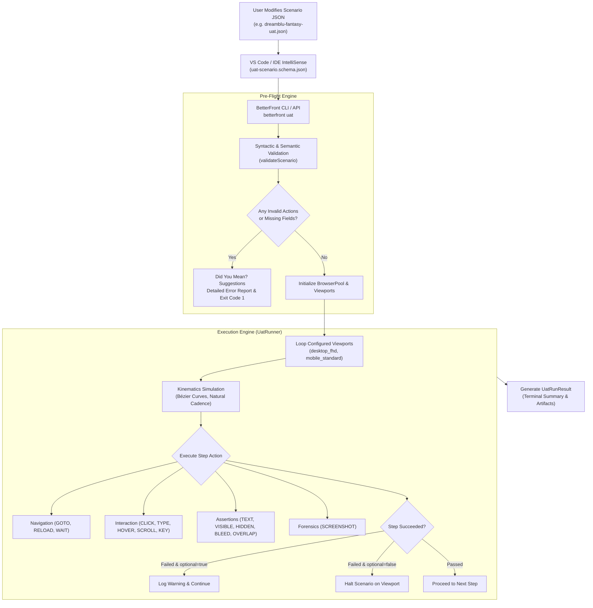
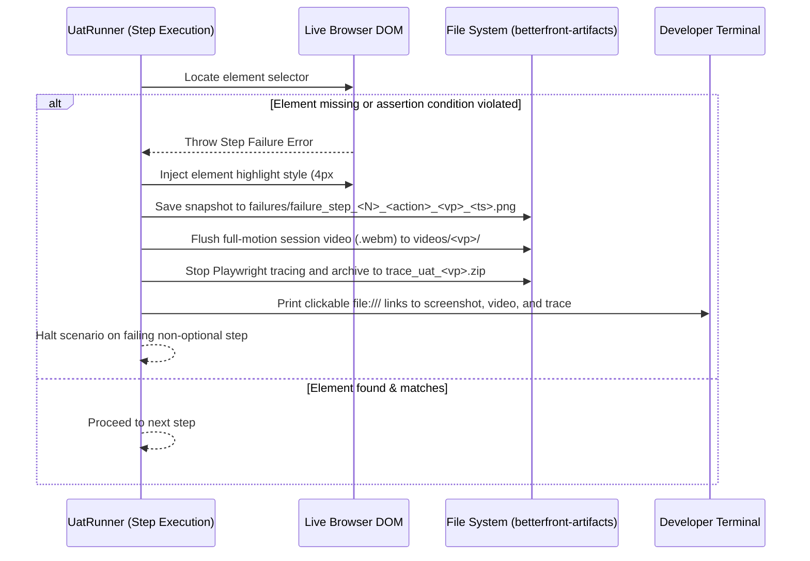

# BetterFront Declarative UAT Engine Specification & Action Guide
## Production-Grade Frontend Quality Assurance Standard

---

### Executive Overview

Modern frontend engineering requires end-to-end user acceptance testing (UAT) that is:
1. **Resilient**: Immune to minor DOM timing variations and flakiness.
2. **Accessible to Non-Engineers**: Editable by product managers, designers, and QA leads without writing complex test code.
3. **Multi-Dimensional**: Simultaneously verifying visual aesthetics (text collisions, mobile bleed), runtime stability (console exceptions), and business user flows.
4. **Tool-Integrated**: Supported by JSON Schema autocompletion, real-time linting, and pre-flight validation.

BetterFront delivers this through its **Declarative UAT Engine**. Scenarios are defined in human-readable JSON files with typed step actions, verified by pre-flight validation, and executed with human kinematics simulation.

---

### Architecture & Pipeline



---

### Complete Action Catalog & Runtime Behavior

#### 1. Navigation Actions

| Action | Parameters | Runtime Behavior | Error Handling |
| :--- | :--- | :--- | :--- |
| `GOTO` | `url` (required)<br/>`timeoutMs` (optional) | Resolves relative URLs (e.g. `"/shop"`) against `scenario.startUrl` or `scenario.baseUrl`. Waits for `domcontentloaded`. | Throws if navigation fails or times out. |
| `RELOAD` | `timeoutMs` (optional) | Triggers `page.reload()`, maintaining session cookies and storage. | Throws if reload times out. |
| `WAIT` | `waitMs` (optional, default 1000) | Sleeps the thread for specified milliseconds. | None. |
| `WAIT_FOR` | `selector` (required)<br/>`state` (`visible` \| `hidden` \| `attached` \| `detached`)<br/>`timeoutMs` (optional) | Dynamically polls locator until desired DOM state is reached. | Throws if state is not achieved within timeout. |
| `WAIT_FOR_NAV` | `url` (optional)<br/>`timeoutMs` (optional) | Waits for page URL change or navigation completion. | Throws if navigation event does not occur within timeout. |

#### 2. Human Interaction Actions

| Action | Parameters | Runtime Behavior | Error Handling |
| :--- | :--- | :--- | :--- |
| `CLICK` | `selector` (required)<br/>`timeoutMs` (optional) | Calculates Bézier trajectory with human jitter and clicks. Falls back to direct locator click if kinematics blocked. | Throws if element is not found or not interactable. |
| `DOUBLE_CLICK` | `selector` (required)<br/>`timeoutMs` (optional) | Waits for element visibility and executes two rapid clicks. | Throws if element is not visible within timeout. |
| `HOVER` | `selector` (required)<br/>`timeoutMs` (optional) | Moves cursor along natural Bézier path to element coordinates, activating CSS `:hover` states and drop-downs. | Throws if element is not visible within timeout. |
| `TYPE` | `selector` (required)<br/>`text` (required)<br/>`clearFirst` (default true)<br/>`pressEnter` (default false)<br/>`delayMs` (optional) | Simulates realistic human typing cadence. Supports clearing before typing and automatically pressing Enter. | Throws if input element cannot be focused. |
| `CLEAR` | `selector` (required)<br/>`timeoutMs` (optional) | Clears text inside `<input>` or `<textarea>`. | Throws if element is not interactable. |
| `PRESS_KEY` | `key` (required)<br/>`selector` (optional) | Dispatches a native keyboard press (e.g. `'Enter'`, `'Escape'`, `'Tab'`, `'Space'`, `'ArrowDown'`). | Throws if element cannot be focused. |
| `SELECT` | `selector` (required)<br/>`value` or `text` (required) | Selects option in `<select>` dropdown by attribute value or visible text label. | Throws if matching option is not found. |
| `CHECK` / `UNCHECK` | `selector` (required) | Checks or unchecks native HTML checkbox or radio input. | Throws if input is disabled or not found. |
| `SCROLL` | `scrollPx` (optional, default 500)<br/>`direction` (`down` \| `up`) | Generates realistic human scrolling with inertia and content density reading pauses. | None. |
| `SCROLL_TO` | `selector` (required) | Scrolls element into viewport using smooth alignment. | Throws if element is not found. |
| `FILL_FORM` | `profile` (optional) | Autonomously scans page for empty inputs and populates with contextual synthetic Faker data. | Gracefully skips fields that cannot be filled. |
| `EXECUTE_SCRIPT` | `script` (required) | Evaluates custom JavaScript string inside the browser context. | Throws if script execution throws an exception. |

#### 3. Assertions & Defect Detection

| Action | Parameters | Verification Logic |
| :--- | :--- | :--- |
| `ASSERT_VISIBLE` | `selector` (required) | Element is attached, has non-zero bounding box, and is visible. |
| `ASSERT_HIDDEN` | `selector` (required) | Element is detached from DOM or has `display: none` / `visibility: hidden`. |
| `ASSERT_TEXT` | `selector` (required)<br/>`text` (required)<br/>`exact` (default false) | Inner text contains expected substring (or strict equality if `exact: true`). |
| `ASSERT_VALUE` | `selector` (required)<br/>`value` / `text` (required) | Evaluates `.inputValue()` of input, textarea, or select element. |
| `ASSERT_COUNT` | `selector` (required)<br/>`count` (required)<br/>`operator` (`equals` \| `greaterThan` \| `lessThan`) | Compares `.count()` of matching elements against threshold. |
| `ASSERT_URL` | `url` (required) | Current window URL contains expected string or pattern. |
| `ASSERT_TITLE` | `text` (required) | Document title contains expected string. |
| `ASSERT_NO_OVERLAP` | *none* | Mathematical visual collision detection between text bounding boxes. |
| `ASSERT_NO_BLEED` | *none* | Verifies no element has horizontal overflow on mobile viewports (< 430px). |
| `ASSERT_NO_CONSOLE_ERRORS` | *none* | Verifies zero unhandled exceptions captured by `page.on('pageerror')`. |
| `ASSERT_UNOCCLUDED` | `selector` (required) | Hit-tests `elementFromPoint(cx, cy)` to assert element is not blocked by sticky headers, navbars, or overlays. |
| `ASSERT_NO_CLIPPING` | `selector` (optional) | Verifies element or page has zero hidden text truncation/starvation (`scrollHeight > clientHeight`). |
| `ASSERT_TOUCH_TARGET` | `selector` (required)<br/>`minPx` (optional, default 44) | Asserts element bounding box meets touch target ergonomics ($44\times 44\text{px}$ per Apple HIG / WCAG 2.5.5). |
| `ASSERT_CONTRAST` | `selector` (required)<br/>`minRatio` (optional, default 4.5) | Computes relative luminance ratio against background to verify WCAG AA compliance (4.5:1). |

#### 4. Forensics

| Action | Parameters | Verification Logic |
| :--- | :--- | :--- |
| `SCREENSHOT` | `name` (optional)<br/>`fullPage` (default false) | Takes high-resolution screenshot saved to `./betterfront-artifacts/screenshots/`. |

---

### Multi-Device Viewport Matrix

Scenarios can declare specific viewports to execute against:

```json
{
  "viewports": [
    "desktop_fhd",
    "mobile_standard",
    "tablet_portrait"
  ]
}
```

Standard predefined viewports:
- `desktop_fhd`: 1920x1080 (Desktop 1080p)
- `desktop_laptop`: 1366x768 (Standard Laptop)
- `tablet_portrait`: 820x1180 (iPad Air)
- `mobile_standard`: 390x844 (iPhone 14/15/16)
- `mobile_android`: 412x915 (Google Pixel / Samsung Galaxy)
- `mobile_compact`: 375x667 (iPhone SE)
- `foldable`: 280x653 (Samsung Galaxy Fold cover)

---

### Step Modifiers & Fault Tolerance

#### 1. Optional Steps (`optional: true`)
When testing real-world applications, non-deterministic elements often appear (e.g. cookie consent banners, daily login announcements, newsletter prompts).

Marking a step with `"optional": true` ensures that if the element is not found, the runner:
1. Logs an advisory warning in the console: `⚠️ [Optional Warning]: Could not find #daily-announcement-modal`.
2. Marks the step as passed with a warning note.
3. Continues scenario execution without failing the test suite.

```json
{
  "action": "CLICK",
  "selector": ".modal-announcement .btn-close",
  "optional": true,
  "timeoutMs": 2500,
  "description": "Dismiss daily announcement popup if shown"
}
```

#### 2. Per-Step Custom Timeouts (`timeoutMs`)
Default timeouts:
- Element lookups: 8,000ms
- Dynamic wait (`WAIT_FOR`): 10,000ms
- Navigation (`GOTO`, `RELOAD`): 30,000ms

To override for slow operations:
```json
{
  "action": "WAIT_FOR",
  "selector": "#heavy-3d-canvas",
  "state": "visible",
  "timeoutMs": 25000,
  "description": "Wait up to 25s for WebGL scene to compile"
}
```

---

### CLI Reference

```bash
# Validate syntax and actions only (exit 0 if valid, exit 1 if invalid)
betterfront uat <scenarioFile> --validate-only

# Run headless across configured viewports
betterfront uat <scenarioFile>

# Record full-motion WebM video and Playwright trace archive of the UAT run
betterfront uat <scenarioFile> --video --trace

# Run in interactive headed mode
betterfront uat <scenarioFile> --headed

# Slow down execution by 250ms per step
betterfront uat <scenarioFile> --headed --slowmo 250

# Override viewport to desktop Full HD
betterfront uat <scenarioFile> --viewport desktop_fhd

# Live Action Recording: launch browser and record clicks/inputs to scenario JSON
betterfront record http://localhost:7777 -o ./uat-scenarios/my-flow.json

# Explicitly enable or disable video / trace / failure screenshots
betterfront uat <scenarioFile> --video --trace --screenshot-on-failure
betterfront uat <scenarioFile> --no-video --no-trace --no-screenshot-on-failure
```

---

### Forensic Error Recording & Exact Problem Capture Architecture

BetterFront treats failures as critical forensic incidents. When an assertion or DOM interaction fails during UAT:



#### Dual Configuration Model:
1. **Declarative (Scenario JSON):**
   ```json
   "recording": {
     "video": true,
     "trace": true,
     "screenshotOnFailure": true,
     "artifactsDir": "./betterfront-artifacts"
   }
   ```
2. **Imperative (CLI Flags):**
   - `--video` / `--no-video`
   - `--trace` / `--no-trace`
   - `--screenshot-on-failure` / `--no-screenshot-on-failure`
   - `--artifacts-dir <path>`


