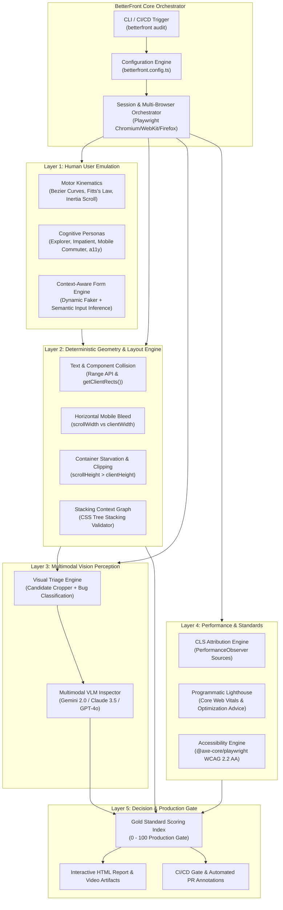

# BetterFront: Gold-Standard Automated Frontend QA & Production-Readiness Engine
## Document 00: Master Index & Executive Architecture Summary

---

### Executive Vision

Modern web development has evolved at breakneck speed. Teams deploy micro-frontends, server-side rendered hydration frameworks (Next.js, Remix, Nuxt, SvelteKit), design systems with hundreds of responsive components, and complex dynamic user experiences dozens of times a day.

However, **Frontend Quality Assurance (QA) remains fundamentally broken.**

Most automated testing today relies on two extreme and flawed paradigms:
1. **Brittle Unit & Component Tests:** Asserting that a button has a specific class or renders a specific string in jsdom/mock environments fails to capture how that button renders when actual CSS cascades, responsive breakpoints collapse, web fonts load asynchronously, or dynamic localization text wraps.
2. **Fragile Pixel-Diffing E2E Tests:** Tools like traditional screenshot comparison (`toHaveScreenshot()`) trigger false alarms over a single anti-aliased subpixel, slight font rendering differences between macOS and Linux CI workers, or dynamic timestamps, while completely missing real human-experience disasters such as:
   - Text overflowing outside cards or wrapping under sticky footers.
   - Buttons clipped by fixed container heights (`height: 48px; overflow: hidden;`).
   - Sticky navigation bars occluding page headings on anchor scroll.
   - Cumulative Layout Shifts (CLS) jumping 200px downwards right as a user clicks "Buy Now".
   - Sideways page wobble (horizontal overflow) on mobile viewports (375px) due to an unconstrained `width: 100vw` or hardcoded image width.
   - Dropdown menus rendering behind modal overlays due to z-index stacking context isolation.

**BetterFront** is designed to solve this crisis by creating the **"Gold Industry Standard" Automated Frontend Gatekeeper**. 

BetterFront simulates how a **real human user** explores, perceives, and stresses a web application—combining:
- **Autonomous Human-Like Exploration:** Physics-based mouse trajectories, dwell times, realistic typing, natural scrolling, and persona-driven journey discovery.
- **Deterministic DOM Mathematical Geometry:** Zero-false-positive layout collision algorithms using `Range.getClientRects()`, CSS computed stacking context analyzers, and viewport boundary checks.
- **Cognitive Vision Intelligence (Multimodal VLM):** Senior UI/UX visual validation that visually audits layout candidates, distinguishing intentional overlapping aesthetics (e.g. stacked avatar groups, badge tags) from genuine rendering catastrophes.
- **Real-Time Core Web Vitals & Performance Auditing:** Precise layout shift (CLS) element-level attribution via Chrome DevTools Protocol & `PerformanceObserver`, synthetic throttling, and programmatic Lighthouse scoring.
- **Production-Ready Quality Gates:** A strict, objective scoring index (0–100) determining whether a frontend is genuinely ready for production traffic.

---

### System Architecture Diagram

---

### Master Strategy Document Index

The strategies in this folder form a complete, production-ready specification and engineering blueprint:

| File | Title | Scope & Key Contents |
| :--- | :--- | :--- |
| **[01_STACK_EVALUATION_AND_RECOMMENDATIONS.md](./01_STACK_EVALUATION_AND_RECOMMENDATIONS.md)** | **Tech Stack Analysis & Architecture Decisions** | Exhaustive benchmark of Playwright vs Puppeteer vs Cypress; Stagehand vs Midscene.js vs Browser-Use; Lighthouse Core vs CDP; exact library selection and dependency matrix. |
| **[02_AUTONOMOUS_HUMAN_USER_SIMULATION.md](./02_AUTONOMOUS_HUMAN_USER_SIMULATION.md)** | **Autonomous Human-Like Agent Strategy** | Non-linear Bezier mouse mechanics, scroll inertia, typing cadence with intentional errors, heuristic exploratory crawlers, and chaos stress testing (rage clicking, double submits, orientation changes). |
| **[03_VISUAL_DEFECT_DETECTION_ENGINE.md](./03_VISUAL_DEFECT_DETECTION_ENGINE.md)** | **Visual Defect & Layout Collision Engine** | Mathematics of `Range.getClientRects()` text collision, z-index stacking context traversal, mobile horizontal bleed pinpointing, text clipping, and the two-stage VLM visual verification pipeline. |
| **[04_RESPONSIVENESS_AND_DEVICE_MATRIX.md](./04_RESPONSIVENESS_AND_DEVICE_MATRIX.md)** | **Responsiveness & Cross-Device Matrix** | Full viewport testing matrix (280px foldable to 3840px 4K), fluid breakpoint sweep scanning, 200% browser text zoom stress, touch target WCAG audit (48x48px), and notch/safe-area verification. |
| **[05_PERFORMANCE_LIGHTHOUSE_AND_OPTIMIZATION.md](./05_PERFORMANCE_LIGHTHOUSE_AND_OPTIMIZATION.md)** | **Lighthouse & Core Web Vitals Engine** | Programmatic Lighthouse runner, real-time layout shift (CLS) element attribution via `PerformanceObserver`, INP main thread monitoring, asset bloat diagnostics, and automated remediation engine. |
| **[06_UAT_AND_PRODUCTION_READINESS_STANDARD.md](./06_UAT_AND_PRODUCTION_READINESS_STANDARD.md)** | **UAT & Production Readiness Quality Gate** | The "Gold Standard" score equation (0–100), Hard Blocker vs Soft Warning criteria, synthetic user journey orchestrator, automated PR gating, and artifact delivery. |
| **[07_SYSTEM_ARCHITECTURE_AND_IMPLEMENTATION_BLUEPRINT.md](./07_SYSTEM_ARCHITECTURE_AND_IMPLEMENTATION_BLUEPRINT.md)** | **System Architecture & Code Structure** | Clean modular architecture, CLI interface, configuration schema (`betterfront.config.ts`), TypeScript data contracts, and report generation pipeline. |
| **[08_READY_TO_RUN_POC_AND_SCAFFOLDING.md](./08_READY_TO_RUN_POC_AND_SCAFFOLDING.md)** | **Proof-of-Concept & Working Code Scaffolding** | Production-ready, runnable TypeScript scripts for DOM collision, CLS attribution, horizontal overflow detection, and Playwright human-user driver. |

---

### Core Tenets of the "Gold Industry Standard"

1. **Zero Flakiness:** Tests must never fail due to subpixel anti-aliasing variations or network jitter. Assertions are based on mathematical geometry, structural invariants, and semantic visual logic.
2. **Root-Cause Attribution:** BetterFront never simply says "Something broke." It returns the exact DOM node, its computed CSS properties, its coordinates, a highlighted visual snapshot, and the specific CSS property causing the defect (e.g. `overflow: hidden without height adjustment` or `missing aspect-ratio on `).
3. **Dual-Brain Verification:** Math catches 100% of candidate collisions in milliseconds. Cognitive Multimodal AI filters out intended graphic design patterns (avatars, badges, watermarks), yielding zero false positives.
4. **Developer Actionability:** Every detected bug comes with an automated remediation suggestion (e.g. `Suggested fix: replace width: 100vw with width: 100%` or `add flex-wrap: wrap; to .nav-container`).
