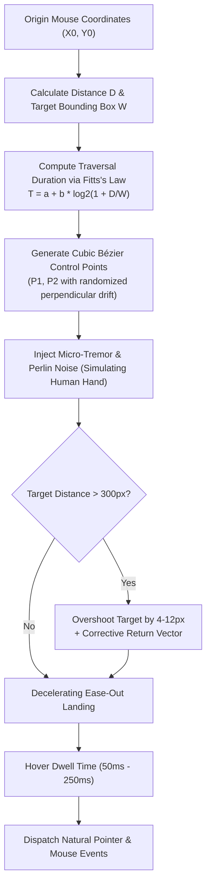
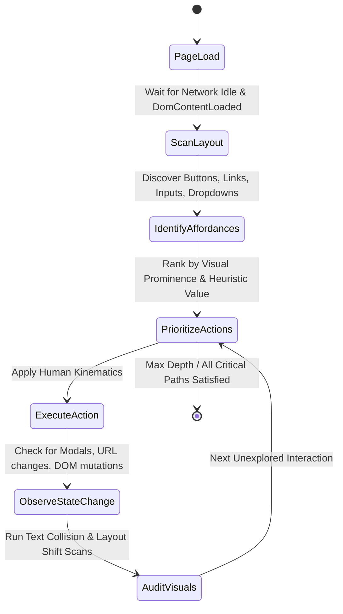

# BetterFront: Gold-Standard Automated Frontend QA & Production-Readiness Engine
## Document 02: Autonomous Human-Like Agent Simulation

---

### 1. The Human Simulation Paradigm

Traditional automated testing fails to uncover production bugs because it acts like a robot:
- It **teleports** the cursor directly to the center of a button in 0 milliseconds (`page.click()`), never triggering hover cascades, mouse-leave edge cases, or dropdown delay timers.
- It **injects text values instantaneously** (`page.fill('input', 'text')`), completely bypassing real DOM `keydown`, `keypress`, `keyup`, and input debouncing logic.
- It **scrolls instantly** to coordinates (`window.scrollTo(0, 500)`), failing to trigger scroll-driven CSS animations, IntersectionObserver lazy-loading triggers, sticky headers, or Cumulative Layout Shifts caused by dynamic ad injection.
- It executes a **rigid, pre-scripted golden path**, completely blind to the messy, exploratory, and impatient ways real human beings actually use web applications.

BetterFront implements a **Tri-Layer Human Simulation Model**:
1. **Kinematics Engine:** Physics-grounded motor simulation (Bézier curves, Fitts's Law, scroll momentum, Gaussian typing latency).
2. **Cognitive Traversal Engine:** Visual-attention-guided exploratory state exploration.
3. **Adversarial Chaos Personas:** Stress testing for race conditions, rage clicking, form boundary abuse, and mid-interaction device rotation.

---

### 2. Motor Kinematics & Physics

#### 2.1 Bézier Trajectory Generation & Fitts's Law
When a human moves a mouse to a target on screen, the movement is neither a straight line nor uniform in speed. It follows Fitts's Law of psychomotor precision:

$$T = a + b \cdot \log_2\left(1 + \frac{D}{W}\right)$$

Where:
- $D$ is the Euclidean distance to the target element.
- $W$ is the target element's effective width or height in the direction of motion.
- $a$ and $b$ are empirical motor constants (default: $a \approx 100\text{ms}$, $b \approx 150\text{ms}$).

The trajectory is modeled as a Cubic Bézier curve defined by four control points:
- $P_0$: Starting coordinates $(x_0, y_0)$.
- $P_1 = P_0 + \vec{v}_1 + \vec{\delta}_1$: Primary acceleration vector with a lateral drift angle.
- $P_2 = P_3 - \vec{v}_2 + \vec{\delta}_2$: Deceleration guide vector aiming into the target's bounding box.
- $P_3$: Target landing coordinates $(x_t, y_t)$ (randomized within the inner 60% of the element to avoid clicking exact borders).

#### 2.2 Humanized Scroll Mechanics
Real humans scroll using mouse wheels, trackpads, or mobile finger swipes with **inertia and friction**:
- **Scroll Bursts:** Discrete wheel ticks with non-linear velocity decay.
- **Reading Dwell Times:** After scrolling into a new viewport section, the agent pauses. The pause duration is dynamically proportional to the visible text density:
  $$\text{DwellTime} = \min(4000\text{ms}, \max(400\text{ms}, N_{\text{words}} \times 25\text{ms}))$$
- **Scroll-and-Adjust:** When looking for a specific section, humans frequently scroll slightly past it and then adjust back 40–80px upwards. BetterFront mimics this micro-reversal to test scroll-pinned headers and sticky elements.

#### 2.3 Realistic Typing Cadence with Error Correction
To thoroughly stress auto-complete dropdowns, debounced API calls, and validation banners:
- **Variable Key Latency:** Inter-keystroke delays follow a log-normal distribution ($\mu \approx 120\text{ms}$, $\sigma \approx 35\text{ms}$).
- **Burst Typing:** Characters within common syllables (e.g. "ing", "tion", "the") are typed significantly faster than cross-keyboard transitions.
- **Intentional Typos & Backspacing:** At a configurable error rate (e.g. 3%), the agent strikes an adjacent QWERTY key, pauses for 180–300ms (cognitive realization delay), presses `Backspace`, and resumes with the intended character.

---

### 3. Cognitive Traversal & Exploratory Navigation

Rather than depending on brittle hardcoded XPath selectors, BetterFront's autonomous crawler explores the application like a curious human visitor:

#### 3.1 Affordance Discovery Engine
On any rendered page or dialog, the agent automatically identifies all interactive elements using an extensible semantic scoring filter:
- Standard interactive elements: `<button>`, `<a href>`, `<input>`, `<select>`, `<textarea>`.
- ARIA semantics: `[role="button"]`, `[role="link"]`, `[role="checkbox"]`, `[role="menuitem"]`, `[role="tab"]`.
- Style-based affordances: Elements with computed CSS `cursor: pointer` or explicit `tabindex="0"`.
- Hidden state handlers: Elements inside closed accordion headers, hamburger menu triggers, and dropdown toggles.

#### 3.2 State Deduplication & Loop Prevention
To avoid getting trapped in infinite carousels or circular navigation loops:
- Every unique DOM state is assigned a **Structural State Hash**:
  $$\text{StateHash} = \text{SHA256}(\text{NormalizedURL} + \text{OrderedInteractiveElements} + \text{VisibleHeadings})$$
- The agent maintains an internal Directed Graph of visited states and transitions. When an action leads back to an already exhausted state, the agent backtracks or selects the next highest priority unexplored branch.

#### 3.3 Semantic Context-Aware Form Filling
When the agent encounters a form (registration, checkout, contact, lead generation), it uses contextual field heuristics to inject realistic data via `@faker-js/faker`:

| Input Name / Label / Placeholder / Type | Semantic Classification | Injected Synthetic Data |
| :--- | :--- | :--- |
| `type="email"` or `name*="email"` | Email Address | Realistic formatted email (`faker.internet.email()`) |
| `type="password"` or `name*="pass"` | Password | Strong compliant password (`faker.internet.password({ length: 14 })`) |
| `type="tel"` or `name*="phone"` | Phone Number | Valid E.164 phone string (`faker.phone.number()`) |
| `name*="name"`, `name*="first"` | First Name | Natural human name (`faker.person.firstName()`) |
| `name*="address"`, `name*="street"` | Postal Address | Street address (`faker.location.streetAddress()`) |
| `name*="zip"`, `name*="postal"` | ZIP / Postal Code | Matching postal code (`faker.location.zipCode()`) |
| `name*="card"`, `autocomplete="cc-number"` | Credit Card (Test) | Standard Stripe 4242 test number (`faker.finance.creditCardNumber()`) |
| `<textarea>`, `name*="message"`, `name*="bio"` | Multiline Text | Multi-sentence paragraph testing word wrapping |

---

### 4. Human Persona Archetypes

BetterFront provides four built-in behavioral personas to audit the application under radically different usage habits:

#### Persona 1: "The Impatient Mobile Commuter"
- **Device:** Small Viewport (375x667, 390x844), Touch emulation active.
- **Behavior:** Rapid, erratic scrolling. Scrolls before images finish loading. Tap latency under 80ms.
- **Stress Objective:** Uncovers Cumulative Layout Shift (CLS) as late-loading images pop in above the user's reading position; tests mobile hamburger menus and bottom navigation bars.

#### Persona 2: "The Frustrated Rage-Clicker"
- **Behavior:** Fires rapid bursts of 5–10 clicks within a 400ms window on buttons and submit elements.
- **Stress Objective:** Tests frontend button debounce locks, prevents duplicate API submissions, and discovers whether buttons freeze in loading spinners permanently.

#### Persona 3: "The Boundary-Pusher (Chaos Explorer)"
- **Behavior:** Injects boundary inputs into text fields:
  - Strings of 500+ characters with no spaces (`"WWWWWWWWWWWWWW..."`) to test CSS word-wrap and container blowout.
  - Multi-byte UTF-8, Arabic/Hebrew RTL text, and emojis (`"🎉🚀🔥💡"`).
  - HTML tags (``) to verify DOM escaping.
- **Stress Objective:** Uncovers text truncation failures, missing `overflow-wrap: break-word;`, and UI layout breakage from international characters.

#### Persona 4: "The Keyboard-Only Accessible User"
- **Behavior:** Interacts exclusively through sequential keyboard events: `Tab`, `Shift+Tab`, `Enter`, `Space`, and Arrow keys. Never touches mouse pointer.
- **Stress Objective:** Verifies whether `:focus-visible` outline rings are clearly rendered, ensures no modal focus traps capture the cursor irreversibly, and checks that tab sequence matches visual reading order.

---

### 5. Adversarial Testing Scenarios (Production Edge Cases)

Real humans subject frontends to chaotic conditions that standard tests ignore:

#### 5.1 Dynamic Viewport Rotation Mid-Session
- **Scenario:** The user opens a modal dialogue on a mobile device in portrait mode (390x844), then rotates the device to landscape mode (844x390).
- **Audit Verification:**
  - Does the modal vertically expand off-screen, hiding the "Submit" and "Close" buttons with no internal scrollbar?
  - Does the backdrop overlay remain full screen or leave an un-obscured gap?

#### 5.2 Network Flakiness & Offline Recovery
- **Scenario:** BetterFront uses Playwright CDP network conditions to simulate:
  1. Offline state (`page.context().setOffline(true)`) while typing in a form.
  2. Clicking "Submit".
  3. Verifying that a clean, human-readable error banner appears (not an uncaught promise rejection in the console or infinite spinner).
  4. Restoring network (`setOffline(false)`) and verifying seamless retry capability.

#### 5.3 Double-Navigation & Rapid Back/Forward Caching
- **Scenario:** The user clicks a link, immediately clicks the browser Back button before the target finishes rendering, and then clicks Forward again.
- **Audit Verification:** Tests bfcache (back/forward cache) hydration integrity, ensuring state does not corrupt, event listeners do not duplicate, and blank screens do not occur.
