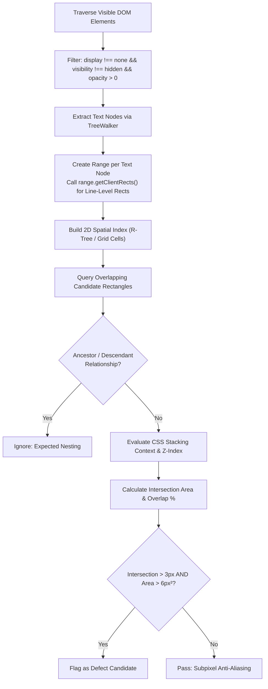
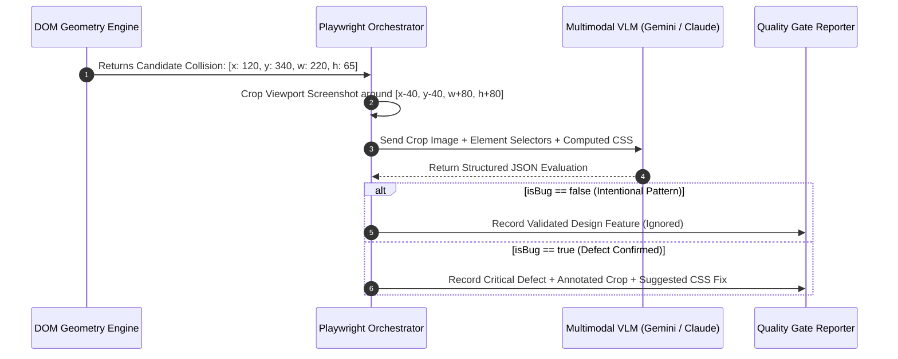

# BetterFront: Gold-Standard Automated Frontend QA & Production-Readiness Engine
## Document 03: Visual Defect & Layout Collision Engine

---

### 1. The Anatomy of Modern Layout Failures

Visual layout defects are among the most embarrassing bugs in software. They destroy brand credibility, break checkout conversions, and cause severe accessibility failures. 

Traditional E2E testing frameworks are completely blind to layout defects because an element can be:
- Successfully mounted in the DOM.
- Returning `toBeVisible() === true`.
- Emitting click events.
- **Yet visually illegible or broken** because another element is rendering directly over its text, or its container has clipped off half its content!

BetterFront classifies and detects the **Six Deadly Visual Defects**:

```
+-------------------------------------------------------------------------------+
|                        THE SIX DEADLY VISUAL DEFECTS                          |
+-------------------------------------------------------------------------------+
| 1. Text-on-Text Overlap       | Text nodes collide; characters cross-render    |
| 2. Component Occlusion        | Buttons/Cards covered by headers or modals    |
| 3. Text & Content Clipping    | Descenders cut off or lines hidden by fixed H |
| 4. Horizontal Viewport Bleed  | Mobile horizontal scrollbar & layout wobble   |
| 5. Stacking Context Inversion | Dropdowns render behind iframes / cards       |
| 6. Container Flex Blowout     | Unconstrained content forces parent overflow   |
+-------------------------------------------------------------------------------+
```

---

### 2. Mathematical DOM Geometry: The Exact Algorithms

To eliminate the massive computational overhead and latency of sending thousands of full-page screenshots to AI models, BetterFront executes an in-browser mathematical geometry scanner that audits the entire DOM tree in **under 15 milliseconds**.



#### 2.1 Why `getBoundingClientRect()` Fails and `Range.prototype.getClientRects()` Succeeds
Calling `el.getBoundingClientRect()` on a block element (like `<p>` or `<div>`) returns a single encompassing rectangle. If the paragraph wraps across 4 lines with a dynamic width, the bounding box includes all empty whitespace to the right of short lines. Comparing bounding boxes of such elements produces overwhelming numbers of **false positive collisions**.

**The BetterFront Line-Level Range Algorithm:**
Instead of inspecting elements, BetterFront traverses the actual **Text Nodes** in the DOM:

```typescript
function extractRenderedTextRects(root: Element = document.body): Array<{ node: Text; rect: DOMRect; text: string }> {
  const walker = document.createTreeWalker(root, NodeFilter.SHOW_TEXT, {
    acceptNode(node) {
      if (!node.textContent || node.textContent.trim().length === 0) {
        return NodeFilter.FILTER_REJECT;
      }
      const parent = node.parentElement;
      if (!parent) return NodeFilter.FILTER_REJECT;
      
      const style = window.getComputedStyle(parent);
      if (style.display === 'none' || style.visibility === 'hidden' || parseFloat(style.opacity) === 0) {
        return NodeFilter.FILTER_REJECT;
      }
      return NodeFilter.FILTER_ACCEPT;
    }
  });

  const textRects: Array<{ node: Text; rect: DOMRect; text: string }> = [];
  const range = document.createRange();

  let currentNode = walker.nextNode();
  while (currentNode) {
    range.selectNodeContents(currentNode);
    const clientRects = range.getClientRects();
    
    for (let i = 0; i < clientRects.length; i++) {
      const rect = clientRects[i];
      // Ignore zero-dimension or offscreen rects
      if (rect.width > 1 && rect.height > 1) {
        textRects.push({
          node: currentNode as Text,
          rect,
          text: currentNode.textContent?.trim() || ''
        });
      }
    }
    currentNode = walker.nextNode();
  }

  return textRects;
}
```

#### 2.2 Axis-Aligned Bounding Box (AABB) Collision Mathematics
For any two bounding rectangles $A$ and $B$, the intersection dimensions are computed as:

$$\Delta X = \max\left(0, \min(A.\text{right}, B.\text{right}) - \max(A.\text{left}, B.\text{left})\right)$$
$$\Delta Y = \max\left(0, \min(A.\text{bottom}, B.\text{bottom}) - \max(A.\text{top}, B.\text{top})\right)$$
$$\text{Area}_{\text{overlap}} = \Delta X \times \Delta Y$$

Two distinct text or UI fragments are flagged as a collision if and only if:
1. $\Delta X \ge 3.0\text{px}$ (prevents false flags on letter edge kerning)
2. $\Delta Y \ge 3.0\text{px}$ (prevents false flags on line-height margins)
3. $\text{Area}_{\text{overlap}} \ge 12.0\text{px}^2$
4. Element $A$ is neither an ancestor nor a descendant of Element $B$ in the DOM tree.

#### 2.3 Stacking Context & Z-Index Graph Resolution
In modern CSS, `z-index` does not operate on a flat global integer scale. It operates within **Stacking Contexts**. An element with `z-index: 9999` nested inside a parent with `transform: translate3d(0,0,0)` or `opacity: 0.99` creates a local stacking context and can render *behind* a sibling with `z-index: 1`!

BetterFront computes the full **Stacking Context Tree**:
- Evaluates properties creating new stacking contexts:
  - Root element (`<html>`)
  - `position: absolute` or `relative` with `z-index !== auto`
  - `position: fixed` or `sticky`
  - `opacity < 1`
  - `transform`, `filter`, `backdrop-filter`, `perspective`, `clip-path`
  - `isolation: isolate`
  - Flex or Grid children with `z-index !== auto`
- Resolves the true visual rendering order. If an element with a higher computed stacking layer occludes another element with lower stacking layer, BetterFront classifies whether the occlusion is intentional (e.g. a modal backdrop) or an accidental layout overlap.

---

### 3. Detecting Mobile Horizontal Viewport Bleed

One of the most widespread bugs on mobile web applications is **unwanted horizontal scrolling (viewport bleed)**. A user attempts to scroll down, but the page swivels or wobbles side-to-side because an element extends past the viewport boundary.

#### The Detection Algorithm
BetterFront evaluates viewport bleed at every tested responsive breakpoint:

```typescript
function detectHorizontalBleed(): Array<{ element: Element; overflowPx: number; selector: string; computedStyles: Record<string, string> }> {
  const viewportWidth = document.documentElement.clientWidth;
  const offenders: Array<{ element: Element; overflowPx: number; selector: string; computedStyles: Record<string, string> }> = [];

  const allElements = document.querySelectorAll('*');
  allElements.forEach((el) => {
    const rect = el.getBoundingClientRect();
    const style = window.getComputedStyle(el);

    if (style.display === 'none' || style.visibility === 'hidden') return;

    // Check if element's right edge breaches the visible viewport
    const overflowRight = rect.right - viewportWidth;
    
    // Check if element has internal scrollWidth greater than clientWidth without overflow handling
    const internalOverflow = el.scrollWidth - el.clientWidth;

    if (overflowRight > 1.5 || (internalOverflow > 2 && style.overflowX === 'visible')) {
      offenders.push({
        element: el,
        overflowPx: Math.max(overflowRight, internalOverflow),
        selector: getUniqueSelector(el),
        computedStyles: {
          width: style.width,
          maxWidth: style.maxWidth,
          minWidth: style.minWidth,
          margin: style.margin,
          padding: style.padding,
          boxSizing: style.boxSizing,
          overflowX: style.overflowX
        }
      });
    }
  });

  return offenders;
}
```

#### Automatic Root-Cause Attribution:
BetterFront does not just flag the element; it diagnoses the exact CSS anti-pattern:
1. **The `100vw` with Scrollbar Trap:** `width: 100vw;` used instead of `width: 100%;`. (Fix: `width: 100%`).
2. **Fixed Pixel Widths:** Container has `width: 450px;` on a 375px viewport. (Fix: `max-width: 100%; width: 100%;`).
3. **Unbroken Strings / Long URLs:** Table cell or heading has `white-space: nowrap;` without ellipsis. (Fix: `overflow-wrap: anywhere;` or `text-overflow: ellipsis;`).
4. **Negative Margins:** Outer wrapper has `margin-left: -20px; margin-right: -20px;` without parent container `overflow-x: clip;`.

---

### 4. Detecting Text Clipping & Container Starvation

A very common frontend defect is setting a fixed pixel height on a card or button while the text inside wraps or expands:
- The container has `height: 40px; overflow: hidden;`.
- On mobile or when internationalized, the text wraps to 2 lines (54px tall).
- The bottom line or descenders (letters like **g, y, p, q, j**) are abruptly cut off mid-character.

BetterFront detects this by comparing the container's physical layout bounds with the text node's rendered height:
$$\text{IsClipped} = (\text{el.scrollHeight} > \text{el.clientHeight} + 2\text{px}) \land (\text{computedStyle.overflowY} \in [\text{'hidden'}, \text{'clip'}]) \land (\text{computedStyle.textOverflow} \ne \text{'ellipsis'})$$

---

### 5. Multimodal VLM Visual Triage (The "Senior Designer" Eye)

Pure mathematical detection flags all physical overlaps. However, modern UI design includes **intentional overlapping patterns**:
- Stacked avatar groups: A row of overlapping user avatars (`margin-left: -12px`).
- Floating badges: A notification counter tag overlapping the top-right corner of a cart icon.
- Slanted hero watermarks: Faded low-opacity background typography.
- Floating Action Buttons (FAB): A circular "+" button floating over the bottom right corner of content.

To achieve a **true zero-false-positive rate**, BetterFront uses a **Two-Stage Hybrid Pipeline**:
1. Mathematical Engine isolates the candidate overlap bounding rect $(x, y, w, h)$.
2. The Runner takes a focused screenshot crop with a 40px contextual margin.
3. The cropped visual image is passed to a high-speed Multimodal Vision model (Gemini 2.0 Flash / Claude 3.5 Sonnet) with a specialized Visual QA Prompt.



#### 5.1 The Multimodal Vision Prompt Template
The Vision AI prompt is structured with strict behavioral constraints and enforced JSON schema:

```markdown
You are a World-Class Principal UI/UX Quality Assurance Engineer and Frontend Architect.
Analyze the attached visual screenshot crop taken from a web application under automated audit.

Context:
- Target Element A: {elementA_selector}
- Target Element B: {elementB_selector}
- Computed CSS: {computed_css_json}
- Device Viewport: {viewport_width}x{viewport_height}

Audit Guidelines:
1. Examine whether the intersection between the elements represents an UNINTENTIONAL RENDERING DEFECT or an INTENDED DESIGN PATTERN.
2. Intended design patterns include: stacked avatar circles, notification badges on icon corners, intentional card elevation layering, stylized watermark typography.
3. Rendering defects include: text collision rendering unreadable characters, text clipped by fixed-height containers, buttons occluding paragraphs, dropdown menus hidden behind backgrounds, sticky navigation occluding titles.

Return your audit strictly in the following JSON format:
{
  "isBug": boolean,
  "defectType": "NONE" | "TEXT_ON_TEXT_COLLISION" | "COMPONENT_OCCLUSION" | "TEXT_CLIPPING" | "HORIZONTAL_BLEED",
  "severity": "NONE" | "MINOR" | "MAJOR" | "CRITICAL",
  "confidenceScore": number (0.0 to 1.0),
  "humanDescription": "Clear plain-language explanation of what is visually wrong",
  "affectedContent": "The exact text or UI elements that are broken or obscured",
  "rootCauseDiagnosis": "Why this happened from a CSS/layout perspective",
  "suggestedCssRemediation": "Exact CSS rules to fix the defect"
}
```

This dual-brain architecture guarantees both **microsecond mathematical coverage** and **human-level aesthetic discernment**.
