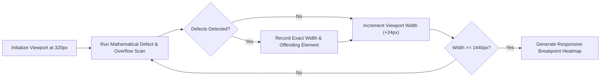

# BetterFront: Gold-Standard Automated Frontend QA & Production-Readiness Engine
## Document 04: Responsiveness & Cross-Device Matrix

---

### 1. The Multi-Viewport Reality

In the modern web, responsive design is not merely three fixed breakpoints (`mobile: 640px`, `tablet: 768px`, `desktop: 1024px`). Users visit web applications across hundreds of distinct screen dimensions—ranging from 280px foldable outer screens to 3840px 4K ultrawide monitors.

Traditional tests run on a single arbitrary viewport (typically 1280x720). Consequently, critical production bugs escape undetected:
- A navigation bar that collapses at 768px but looks completely broken at 800px.
- A 3-column pricing card grid where cards squish to 120px wide at 1050px before wrapping at 1024px.
- Buttons whose touch target is only 18x18px on touchscreens, frustrating mobile users.
- Sticky action bars that overlap the iOS home indicator bar because `env(safe-area-inset-bottom)` was omitted.

BetterFront establishes a **Three-Tier Responsiveness Verification Protocol**:
1. **The Standard Multi-Device Matrix:** Discrete emulation of real hardware profiles.
2. **The Fluid Breakpoint Sweeper:** Continuous dynamic sweep to catch "in-between" layout breakages.
3. **Mobile Human Usability Audits:** Touch target sizes, 200% text zoom stress, and safe-area insets.

---

### 2. The Comprehensive Device Matrix

```
+-----------------------------------------------------------------------------------------+
|                               BETTERFRONT DEVICE MATRIX                                 |
+-----------------------------------------------------------------------------------------+
| Category         | Viewport (W x H)  | DPR  | Touch | Engine   | Representative Device  |
+------------------+-------------------+------+-------+----------+------------------------+
| Foldable Narrow  | 280 x 653         | 3.0  | Yes   | Chromium | Galaxy Fold (Closed)   |
| Compact Mobile   | 320 x 568         | 2.0  | Yes   | WebKit   | iPhone SE (1st Gen)    |
| Standard Mobile  | 375 x 667         | 2.0  | Yes   | WebKit   | iPhone SE (3rd Gen)    |
| Modern Flagship  | 390 x 844         | 3.0  | Yes   | WebKit   | iPhone 14/15/16        |
| Large Android    | 412 x 915         | 2.6  | Yes   | Chromium | Galaxy S23 / Pixel 8   |
| Max Flagship     | 430 x 932         | 3.0  | Yes   | WebKit   | iPhone 15/16 Pro Max   |
+------------------+-------------------+------+-------+----------+------------------------+
| Small Tablet     | 768 x 1024        | 2.0  | Yes   | WebKit   | iPad Mini (Portrait)   |
| Standard Tablet  | 820 x 1180        | 2.0  | Yes   | WebKit   | iPad Air (Portrait)    |
| Tablet Landscape | 1024 x 768        | 2.0  | Yes   | WebKit   | iPad Mini (Landscape)  |
+------------------+-------------------+------+-------+----------+------------------------+
| Laptop Common    | 1366 x 768        | 1.0  | No    | Chromium | Global Laptop Standard |
| Desktop HD       | 1440 x 900        | 2.0  | No    | WebKit   | MacBook Pro 14" Retina |
| Desktop Full HD  | 1920 x 1080       | 1.0  | No    | Chromium | Standard 1080p Monitor |
| Desktop QHD / 2K | 2560 x 1440       | 1.0  | No    | Firefox  | 27" Gaming/Dev Monitor |
| Ultra-Wide / 4K  | 3840 x 2160       | 1.5  | No    | Chromium | 4K UHD Workstation     |
+------------------+-------------------+------+-------+----------+------------------------+
```

---

### 3. The Fluid Breakpoint Sweeper

Testing discrete viewports (e.g. 375px and 768px) creates a massive blindspot: **the transition gaps**. 
Frontends often look flawless at 375px and 768px, but break catastrophically at 640px, 720px, or 1000px due to conflicting `@media` query ranges, fixed-width child containers, or unhandled flex wrap properties.



#### The Sweeper Algorithm:
```typescript
import { Page } from 'playwright';

interface BreakpointAnomaly {
  width: number;
  height: number;
  type: 'HORIZONTAL_OVERFLOW' | 'TEXT_COLLISION' | 'CONTAINER_BLOWOUT';
  elementSelector: string;
  overflowPx: number;
}

export async function sweepBreakpoints(
  page: Page,
  startWidth = 320,
  endWidth = 1440,
  stepPx = 24
): Promise<BreakpointAnomaly[]> {
  const anomalies: BreakpointAnomaly[] = [];
  const fixedHeight = 850;

  for (let width = startWidth; width <= endWidth; width += stepPx) {
    await page.setViewportSize({ width, height: fixedHeight });
    
    // Allow CSS transitions/media queries 50ms to settle
    await page.waitForTimeout(50);

    const bleedResult = await page.evaluate(() => {
      const docWidth = document.documentElement.clientWidth;
      const broken: Array<{ selector: string; overflow: number }> = [];

      document.querySelectorAll('*').forEach((el) => {
        const rect = el.getBoundingClientRect();
        if (rect.right > docWidth + 2) {
          broken.push({
            selector: el.tagName.toLowerCase() + (el.id ? '#' + el.id : '') + (el.className ? '.' + Array.from(el.classList).join('.') : ''),
            overflow: rect.right - docWidth
          });
        }
      });
      return broken;
    });

    if (bleedResult.length > 0) {
      for (const item of bleedResult) {
        anomalies.push({
          width,
          height: fixedHeight,
          type: 'HORIZONTAL_OVERFLOW',
          elementSelector: item.selector,
          overflowPx: item.overflow
        });
      }
    }
  }

  return anomalies;
}
```

---

### 4. Mobile Human Usability Verification

#### 4.1 Touch Target Sizing (WCAG 2.5.5 / 2.5.8 Standard)
On touch-enabled devices, clickable elements that are too small or packed too tightly lead to severe "fat finger" mis-taps.

**Standard Criteria:**
- **Apple iOS Human Interface Guidelines:** Minimum touch target size of **$44 \times 44\text{px}$**.
- **Google Material Design & Android:** Minimum touch target size of **$48 \times 48\text{px}$**.
- **WCAG 2.2 AA (Success Criterion 2.5.8):** Minimum target size of **$24 \times 24\text{px}$** unless sufficient spacing exists between adjacent targets.

BetterFront audits every interactive element on mobile contexts:
```typescript
function auditTouchTargets(): Array<{ selector: string; width: number; height: number; area: number }> {
  const interactiveSelectors = 'button, a, input, select, textarea, [role="button"], [role="link"], [tabindex="0"]';
  const failingElements: Array<{ selector: string; width: number; height: number; area: number }> = [];

  document.querySelectorAll(interactiveSelectors).forEach((el) => {
    const rect = el.getBoundingClientRect();
    const style = window.getComputedStyle(el);

    if (style.display === 'none' || style.visibility === 'hidden' || parseFloat(style.opacity) === 0) return;

    // Check if both dimensions satisfy the 44x44px standard
    if (rect.width > 0 && rect.height > 0 && (rect.width < 44 || rect.height < 44)) {
      // Inline text links within paragraphs are exempt per WCAG
      if (el.tagName === 'A' && el.parentElement && el.parentElement.tagName === 'P') {
        return;
      }

      failingElements.push({
        selector: el.tagName.toLowerCase() + (el.id ? '#' + el.id : ''),
        width: Math.round(rect.width),
        height: Math.round(rect.height),
        area: Math.round(rect.width * rect.height)
      });
    }
  });

  return failingElements;
}
```

#### 4.2 The 200% Text Scaling Stress Test (WCAG 1.4.4 Resize Text)
Under WCAG 1.4.4, content and functionality must not break or be lost when text is zoomed up to 200%.

Many applications hardcode container heights in pixels (`height: 50px`). When a user with visual impairment increases their browser font size to 200%:
- The text size doubles.
- The text wraps to 2 or 3 lines.
- The container height does not expand, causing the text to either clip or collide with elements below it.

BetterFront executes a **Text Zoom Stress Test**:
1. Injects a global root font scale: `document.documentElement.style.fontSize = '200%'`.
2. Re-runs the Visual Defect and Text Collision Engine.
3. Flags any container that suffers text clipping or overlap under 200% zoom.

#### 4.3 Safe Area Inset Validation (Notch & Home Bar)
Modern mobile browsers (iOS Safari, Android Chrome) feature dynamic overlays:
- Top notch / Dynamic Island.
- Bottom floating gesture bar.

Websites that fix footers (`position: fixed; bottom: 0;`) without CSS environment variables cause bottom buttons to be occluded by the device home indicator. BetterFront verifies:
- Use of `padding-bottom: env(safe-area-inset-bottom, 16px);`.
- Use of `padding-top: env(safe-area-inset-top, 0px);`.
