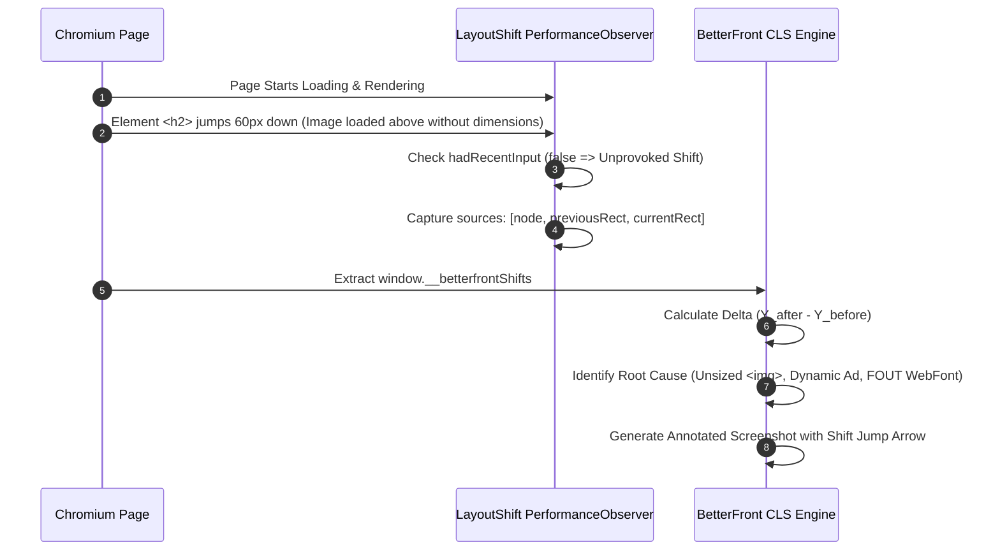

# BetterFront: Gold-Standard Automated Frontend QA & Production-Readiness Engine
## Document 05: Performance, Lighthouse & Optimization Engine

---

### 1. The Real-World Performance Challenge

Fast websites convert users, rank higher on search engines, and deliver seamless experiences. Yet, traditional performance testing is disconnected from reality:
- Running Lighthouse once on an un-throttled desktop Wi-Fi connection produces a deceptive score of 98/100.
- When real users access the page on a mid-tier Android phone over a 4G connection, the page takes 8 seconds to become interactive, and buttons jump 150px down due to late-loading hero images.

BetterFront integrates a **Dual Performance Audit Engine**:
1. **Programmatic Lighthouse Core:** Standardized, lab-benchmarked audits for Performance, Accessibility, Best Practices, and SEO under standardized synthetic mobile throttling (4x CPU slowdown, 1.6 Mbps download, 150ms RTT).
2. **Real-Time Layout Instability (CLS) & INP Attribution:** In-browser event telemetry that catches every single element shift during real human interaction, pinpointing the exact offending DOM node and its root cause.

---

### 2. Core Web Vitals: Gold Standards Matrix

BetterFront evaluates the frontend against the strict Core Web Vitals (CWV) thresholds:

```
+-----------------------------------------------------------------------------------------+
|                              CORE WEB VITALS BENCHMARKS                                 |
+-----------------------------------------------------------------------------------------+
| Metric                             | Good (Pass)     | Needs Work       | Poor (Fail)   |
+------------------------------------+-----------------+------------------+---------------+
| LCP (Largest Contentful Paint)     | <= 2.5s         | 2.5s - 4.0s      | > 4.0s        |
| INP (Interaction to Next Paint)    | <= 200ms        | 200ms - 500ms    | > 500ms       |
| CLS (Cumulative Layout Shift)      | <= 0.10         | 0.10 - 0.25      | > 0.25        |
| FCP (First Contentful Paint)       | <= 1.8s         | 1.8s - 3.0s      | > 3.0s        |
| TTFB (Time to First Byte)          | <= 800ms        | 800ms - 1800ms   | > 1800ms      |
| TBT (Total Blocking Time)          | <= 200ms        | 200ms - 600ms    | > 600ms       |
+------------------------------------+-----------------+------------------+---------------+
```

---

### 3. Real-Time Layout Shift (CLS) Attribution Engine

A generic CLS score of `0.23` is frustrating because it doesn't tell developers *which* element shifted or *why*. 

BetterFront injects an in-browser observer before navigation starts to capture every single layout shift and attribute it directly to specific DOM nodes:



#### 3.1 The Injected In-Browser Attribution Script
```typescript
export const CLS_OBSERVER_INIT_SCRIPT = `
  window.__betterfrontShifts = [];

  const observer = new PerformanceObserver((list) => {
    for (const entry of list.getEntries()) {
      // Ignore shifts triggered within 500ms of user input (expected transitions)
      if (entry.hadRecentInput) continue;

      const shiftData = {
        value: entry.value,
        startTime: entry.startTime,
        sources: []
      };

      if (entry.sources) {
        for (const source of entry.sources) {
          if (!source.node) continue;
          
          const el = source.node;
          const selector = el.tagName.toLowerCase() 
            + (el.id ? '#' + el.id : '')
            + (el.className && typeof el.className === 'string' ? '.' + el.className.trim().split(/\\s+/).join('.') : '');

          shiftData.sources.push({
            selector,
            tagName: el.tagName,
            id: el.id || null,
            className: el.className || null,
            textContent: el.textContent ? el.textContent.trim().substring(0, 50) : null,
            previousRect: {
              top: source.previousRect.top,
              bottom: source.previousRect.bottom,
              left: source.previousRect.left,
              right: source.previousRect.right,
              width: source.previousRect.width,
              height: source.previousRect.height
            },
            currentRect: {
              top: source.currentRect.top,
              bottom: source.currentRect.bottom,
              left: source.currentRect.left,
              right: source.currentRect.right,
              width: source.currentRect.width,
              height: source.currentRect.height
            },
            deltaY: Math.round(source.currentRect.top - source.previousRect.top),
            deltaX: Math.round(source.currentRect.left - source.previousRect.left)
          });
        }
      }

      window.__betterfrontShifts.push(shiftData);
    }
  });

  observer.observe({ type: 'layout-shift', buffered: true });
`;
```

#### 3.2 The Root Cause Diagnosis Heuristics
When a layout shift is recorded, BetterFront inspects preceding DOM siblings and parent styles to categorize the root cause:

| Shift Symptom | Root Cause Pattern | Automated Remediation Recommendation |
| :--- | :--- | :--- |
| Element pushed downward immediately after image request | `` or `<video>` without explicit `width`, `height`, or CSS `aspect-ratio`. | Add `width="..." height="..."` attributes or CSS `aspect-ratio: 16/9;` to reserve space before image decodes. |
| Text re-wraps and jumps vertically 500ms after load | Web Font Flash of Unstyled Text (FOUT) swapped font metrics. | Add `font-display: optional` or `font-display: swap` with metric override (`size-adjust`, `ascent-override`). |
| Content jumps down 80px after JavaScript hydration | Top announcement banner or cookie consent bar injected into DOM without placeholder skeleton. | Render container with fixed `min-height: 80px` in SSR HTML to reserve space. |
| Ad container collapses or expands abruptly | Dynamic third-party advertisement insertion. | Reserve maximum expected ad slot dimensions (`min-height: 250px; min-width: 300px;`). |

---

### 4. Programmatic Lighthouse Integration

BetterFront integrates `@lighthouse/core` directly within the Node.js runtime, connecting to Playwright's active Chromium instance via the Chrome DevTools Protocol port.

```typescript
import lighthouse from 'lighthouse';
import { ChromiumBrowser } from 'playwright';

export interface BetterFrontLighthouseResult {
  scores: {
    performance: number;
    accessibility: number;
    bestPractices: number;
    seo: number;
  };
  metrics: {
    lcp: number;
    fcp: number;
    cls: number;
    tbt: number;
    speedIndex: number;
  };
  opportunities: Array<{
    id: string;
    title: string;
    description: string;
    estimatedSavingsMs?: number;
    estimatedSavingsBytes?: number;
  }>;
}

export async function runProgrammaticLighthouse(
  url: string,
  cdpPort: number,
  isMobile: boolean = true
): Promise<BetterFrontLighthouseResult> {
  const options = {
    logLevel: 'error' as const,
    output: 'json' as const,
    onlyCategories: ['performance', 'accessibility', 'best-practices', 'seo'],
    port: cdpPort,
    formFactor: isMobile ? ('mobile' as const) : ('desktop' as const),
    screenEmulation: isMobile
      ? { mobile: true, width: 390, height: 844, deviceScaleFactor: 3, disabled: false }
      : { mobile: false, width: 1440, height: 900, deviceScaleFactor: 1, disabled: false },
    throttlingMethod: 'simulate' as const
  };

  const runnerResult = await lighthouse(url, options);
  if (!runnerResult || !runnerResult.lhr) {
    throw new Error('Lighthouse execution returned empty result');
  }

  const lhr = runnerResult.lhr;

  const opportunities: BetterFrontLighthouseResult['opportunities'] = [];
  const audits = lhr.audits;

  // Filter high-impact optimization opportunities
  const opportunityAuditKeys = [
    'render-blocking-resources',
    'unused-javascript',
    'unused-css-rules',
    'modern-image-formats',
    'uses-optimized-images',
    'uses-responsive-images',
    'efficient-animated-content',
    'dom-size'
  ];

  for (const key of opportunityAuditKeys) {
    const audit = audits[key];
    if (audit && audit.score !== null && audit.score < 0.9) {
      opportunities.push({
        id: key,
        title: audit.title,
        description: audit.description,
        estimatedSavingsMs: audit.details?.overallSavingsMs,
        estimatedSavingsBytes: audit.details?.overallSavingsBytes
      });
    }
  }

  return {
    scores: {
      performance: Math.round((lhr.categories.performance?.score || 0) * 100),
      accessibility: Math.round((lhr.categories.accessibility?.score || 0) * 100),
      bestPractices: Math.round((lhr.categories['best-practices']?.score || 0) * 100),
      seo: Math.round((lhr.categories.seo?.score || 0) * 100)
    },
    metrics: {
      lcp: audits['largest-contentful-paint']?.numericValue || 0,
      fcp: audits['first-contentful-paint']?.numericValue || 0,
      cls: audits['cumulative-layout-shift']?.numericValue || 0,
      tbt: audits['total-blocking-time']?.numericValue || 0,
      speedIndex: audits['speed-index']?.numericValue || 0
    },
    opportunities
  };
}
```

---

### 5. Automated Optimization Diagnostic Engine

BetterFront translates raw performance data into prioritized, developer-ready action cards:

#### Priority 1: Unused JavaScript & CSS Dead Code Elimination
- Flags total un-executed bytes in client bundles.
- Points to specific script chunks (e.g. `bundle-vendor.js: 480KB total, 390KB unused`).
- Suggests code splitting (`React.lazy()`, dynamic `import()`, route-level chunks).

#### Priority 2: Modern Image Format Pipeline (AVIF / WebP)
- Audits every loaded `` element.
- If raw PNG/JPEG is loaded where WebP/AVIF would reduce file size by > 40%:
  - Generates recommended `<picture>` tag markup with `srcset` and fallback.

#### Priority 3: Render-Blocking Asset Elimination
- Scans all `<link rel="stylesheet">` and `<script>` tags in `<head>`.
- Identifies assets delaying First Contentful Paint.
- Recommends:
  - Critical CSS inlining.
  - Adding `media="print" onload="this.media='all'"` for non-critical CSS.
  - Adding `defer` or `type="module"` to all scripts.
