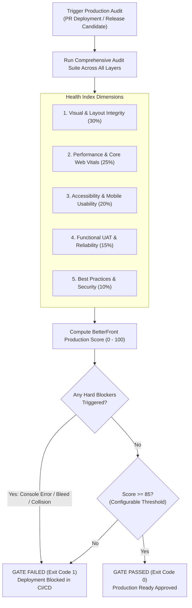

# BetterFront: Gold-Standard Automated Frontend QA & Production-Readiness Engine
## Document 06: UAT & Production-Readiness Quality Gate Standards

---

### 1. The "Gold Industry Standard" Definition

What separates an ordinary test run from a true **"Gold Industry Standard" Production Gate**?

In traditional software organizations, "production-ready" is subjective: a developer tests their feature locally on a 27-inch 4K monitor on Chrome, a QA tester manually clicks through two pages, and the release is approved. In production, thousands of users on Android and iOS devices immediately encounter broken layouts, unclickable buttons, layout shifts during checkout, and unhandled console exceptions.

BetterFront eliminates subjectivity by introducing the **Automated Production-Readiness Gate**: a mathematically calculated, multi-dimensional health index combined with zero-tolerance hard blockers.



---

### 2. The Production Health Index Formula

The **BetterFront Health Score ($S_{\text{total}}$)** is a weighted composite score normalized between 0 and 100:

$$S_{\text{total}} = 0.30 \cdot S_{\text{visual}} + 0.25 \cdot S_{\text{perf}} + 0.20 \cdot S_{\text{a11y}} + 0.15 \cdot S_{\text{uat}} + 0.10 \cdot S_{\text{standards}}$$

#### Dimension Breakdown & Scoring Penalties:

| Dimension | Weight | Scoring Mechanism | Immediate Penalties |
| :--- | :--- | :--- | :--- |
| **$S_{\text{visual}}$ (Visual & Layout)** | **30%** | Starts at 100. | -25 per confirmed text collision;<br/>-20 per horizontal bleed;<br/>-15 per clipped content container. |
| **$S_{\text{perf}}$ (Performance & CWV)** | **25%** | Lighthouse Performance score adjusted for real-time CLS and INP. | -20 if CLS > 0.10;<br/>-30 if LCP > 4.0s;<br/>-15 if INP > 200ms. |
| **$S_{\text{a11y}}$ (Accessibility & Usability)** | **20%** | Axe-core compliance score + touch target compliance ratio. | -15 per critical axe violation;<br/>-5 per undersized touch target (< 44x44px). |
| **$S_{\text{uat}}$ (Functional UAT & Reliability)** | **15%** | Percentage of completed user journeys without functional failure. | -30 per uncaught console exception;<br/>-25 per failed critical API call (5xx/4xx). |
| **$S_{\text{standards}}$ (Best Practices & Security)** | **10%** | Lighthouse Best Practices & SEO score. | -10 for insecure forms;<br/>-10 for missing mobile viewport meta. |

---

### 3. Hard Blockers vs. Soft Warnings

A site cannot be certified as "Production-Ready" if it contains catastrophic defects, regardless of its aggregate score. BetterFront enforces a strict taxonomy of **Hard Blockers**:

#### 3.1 Hard Blockers (Immediate Pipeline Failure - Exit Code 1)
Any occurrence of the following triggers an instant test failure:
1. **Uncaught JavaScript Console Exceptions:** Any `TypeError`, `ReferenceError`, or unhandled promise rejection captured by `page.on('pageerror')`.
2. **Horizontal Viewport Bleed on Mobile (< 430px):** Any element causing horizontal scrolling on iPhone/Android viewports.
3. **Confirmed Text-on-Text Collision:** Any overlapping text nodes that render content illegible, confirmed by the VLM inspector.
4. **Interactive Component Occlusion:** Any critical button, link, or input completely or partially covered by a sticky header, modal backdrop, or floating container.
5. **Critical Network API Failures:** Any 5xx Server Error or unexpected 4xx on first-party REST/GraphQL endpoints.
6. **Cumulative Layout Shift (CLS) > 0.25:** Severe layout instability that violates Google's "Poor" threshold.
7. **Broken Critical UAT Journey:** Failure to complete a core user flow (e.g. checkout, login, signup).

#### 3.2 Soft Warnings (Non-Blocking Alerts)
Logged as warnings in the report and PR comments, but do not block deployment unless warning thresholds are exceeded:
- Lighthouse Performance score between 75 and 89.
- Sub-optimal touch target size on non-primary links (e.g. a footer privacy policy link measuring 36x20px).
- Unused JavaScript bundle size > 150KB.
- Minor color contrast issues on secondary text (contrast between 3.5:1 and 4.5:1).

---

### 4. Autonomous UAT Journey Engine

User Acceptance Testing (UAT) must verify real-world business outcomes, not just static page views. BetterFront provides two operational modes for UAT:

#### 4.1 Mode A: Declarative Core Journey Execution
Developers define critical business paths using a declarative TypeScript workflow syntax:

```typescript
import { BetterFrontScenario } from 'betterfront';

export const CheckoutJourney: BetterFrontScenario = {
  name: 'E-Commerce Guest Checkout Flow',
  description: 'Validates that a guest user can search for a product, add to cart, and reach the payment step without visual or functional defects.',
  startUrl: '/products',
  viewports: ['mobile_standard', 'desktop_fhd'],
  steps: [
    {
      action: 'SEARCH',
      query: 'wireless headphones',
      expectResultsCountGreaterThan: 0
    },
    {
      action: 'CLICK_PRODUCT_CARD',
      cardIndex: 0
    },
    {
      action: 'ASSERT_VISUALS',
      description: 'Product detail page must have zero text collisions between title, price, and specs.'
    },
    {
      action: 'CLICK_CTA',
      selectorText: 'Add to Cart',
      waitForNetworkIdle: true
    },
    {
      action: 'OPEN_DRAWER',
      selector: '#cart-drawer',
      assertNoClipping: true
    },
    {
      action: 'NAVIGATE',
      target: '/checkout'
    },
    {
      action: 'FILL_FORM',
      semanticProfile: 'GUEST_CHECKOUT' // Autonomously fills valid name, address, email, credit card via Faker
    },
    {
      action: 'SUBMIT_FORM',
      expectNoConsoleErrors: true
    }
  ]
};
```

#### 4.2 Mode B: Autonomous Exploratory Roaming (The "Human Auditor" Mode)
When running without pre-defined scripts (e.g., auditing a brand new application, staging environment, or competitor site):
1. **Autonomous Route Discovery:** The agent crawls internal links, discovering all accessible pages, subdomains, and modals.
2. **Dynamic State Transition:** The agent clicks tabs, opens accordions, expands navigation drawers, and switches color schemes (Dark/Light mode).
3. **Continuous Invariant Checking:** After **every single interaction**, the agent evaluates:
   - Did the DOM trigger an unhandled error?
   - Did any text collision occur?
   - Did an element jump causing a layout shift?
   - Is horizontal overflow introduced?
4. **Smart Form Exploration:** Automatically detects unsubmitted forms and tests both valid submissions and boundary error validations.

---

### 5. CI/CD Integration & Automated Pull Request Gating

BetterFront is designed to serve as the definitive gatekeeper in CI/CD pipelines (GitHub Actions, GitLab CI, Bitbucket Pipelines, Jenkins).

```yaml
# .github/workflows/betterfront-gate.yml
name: BetterFront Production Quality Gate

on:
  pull_request:
    branches: [main, master, staging]
  deployment_status:

jobs:
  audit:
    runs-on: ubuntu-latest
    steps:
      - name: Checkout Code
        uses: actions/checkout@v4

      - name: Setup Node.js
        uses: actions/setup-node@v4
        with:
          node-version: 24
          cache: 'npm'

      - name: Install Dependencies
        run: npm ci

      - name: Install Playwright Browsers
        run: npx playwright install --with-deps chromium webkit

      - name: Run BetterFront Production Audit
        env:
          GEMINI_API_KEY: ${{ secrets.GEMINI_API_KEY }}
        run: |
          npx betterfront audit ${{ github.event.deployment_status.target_url || 'http://localhost:3000' }} \
            --preset=production-gate \
            --viewports=mobile,tablet,desktop \
            --output-report=betterfront-report.html \
            --output-json=betterfront-summary.json \
            --fail-on-blocker

      - name: Post PR Quality Annotation
        if: always()
        uses: actions/github-script@v7
        with:
          script: |
            const fs = require('fs');
            if (fs.existsSync('betterfront-summary.json')) {
              const summary = JSON.parse(fs.readFileSync('betterfront-summary.json', 'utf8'));
              const pass = summary.passed;
              const emoji = pass ? '✅' : '🚨';
              const body = `### ${emoji} BetterFront Production Gate: ${pass ? 'APPROVED' : 'BLOCKED'}
              **Overall Score:** ${summary.score}/100
              - **Visual Defects:** ${summary.defectsCount} confirmed
              - **Mobile Bleeds:** ${summary.bleedsCount}
              - **Console Errors:** ${summary.consoleErrorsCount}
              - **Lighthouse Perf:** ${summary.lighthouse.performance}/100
              - **CLS:** ${summary.lighthouse.cls}
              
              [View Detailed Interactive Report](${summary.reportUrl})`;
              
              github.rest.issues.createComment({
                issue_number: context.issue.number,
                owner: context.repo.owner,
                repo: context.repo.repo,
                body: body
              });
            }
```
