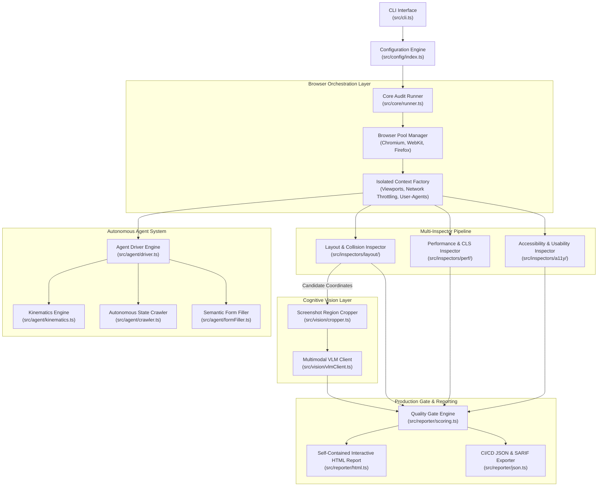

# BetterFront: Gold-Standard Automated Frontend QA & Production-Readiness Engine
## Document 07: System Architecture & Implementation Blueprint

---

### 1. High-Level Modular Architecture

BetterFront is engineered as a modular, decoupled, extensible TypeScript system designed for high concurrency, zero memory leakage, and deterministic audit execution.



---

### 2. Codebase Directory Organization

```
betterfront/
├── bin/
│   └── betterfront.js               # CLI executable entrypoint
├── src/
│   ├── cli.ts                       # Commander.js CLI parser
│   ├── index.ts                     # Public API exports
│   ├── config/
│   │   ├── schema.ts                # Zod configuration validator
│   │   ├── presets.ts               # Pre-configured audit presets
│   │   └── index.ts                 # Config loader
│   ├── core/
│   │   ├── browserPool.ts           # Playwright multi-browser manager
│   │   ├── contextFactory.ts        # Device & viewport emulator
│   │   └── runner.ts                # Main audit coordinator
│   ├── agent/
│   │   ├── kinematics.ts            # Bézier curves, Fitts's Law, jitter
│   │   ├── typist.ts                # Human typing & typo simulator
│   │   ├── scroller.ts              # Inertia scrolling & reading dwells
│   │   ├── crawler.ts               # Autonomous graph state crawler
│   │   └── formFiller.ts            # Contextual Faker form engine
│   ├── inspectors/
│   │   ├── layout/
│   │   │   ├── textCollision.ts     # Range.getClientRects() text scanner
│   │   │   ├── componentOcclusion.ts# Element collision & z-index tree
│   │   │   ├── horizontalBleed.ts   # Mobile horizontal overflow detector
│   │   │   └── textClipping.ts      # Fixed-height container clipping
│   │   ├── perf/
│   │   │   ├── clsObserver.ts       # Real-time layout shift attribution
│   │   │   └── lighthouse.ts        # Programmatic Lighthouse runner
│   │   └── a11y/
│   │       ├── axeRunner.ts         # @axe-core/playwright engine
│   │       ├── touchTargets.ts      # 44x44px touch target compliance
│   │       └── textZoom.ts          # 200% font scaling stress test
│   ├── vision/
│   │   ├── cropper.ts               # Pixel-accurate region cropping
│   │   ├── promptTemplates.ts       # Structured UI inspection prompts
│   │   └── vlmClient.ts             # Gemini 2.0 / Claude 3.5 API client
│   └── reporter/
│       ├── scoring.ts               # Production score & blocker engine
│       ├── html.ts                  # Standalone interactive HTML report
│       └── json.ts                  # CI/CD summary & SARIF exporter
├── strategies/                      # Architectural strategy specifications
├── tests/                           # Engine self-tests
├── package.json
└── tsconfig.json
```

---

### 3. Configuration Specification (`betterfront.config.ts`)

BetterFront is configured via a strongly typed `betterfront.config.ts` file in the project root:

```typescript
import { defineConfig } from 'betterfront';

export default defineConfig({
  // Target website or local development server
  targetUrl: process.env.TARGET_URL || 'http://localhost:3000',

  // Preset: 'production-gate' | 'fast-smoke' | 'comprehensive-deep'
  preset: 'production-gate',

  // Viewports to audit
  viewports: [
    { name: 'mobile_compact', width: 320, height: 568, isMobile: true, hasTouch: true },
    { name: 'mobile_standard', width: 390, height: 844, isMobile: true, hasTouch: true },
    { name: 'tablet_portrait', width: 820, height: 1180, isMobile: true, hasTouch: true },
    { name: 'desktop_fhd', width: 1920, height: 1080, isMobile: false, hasTouch: false }
  ],

  // Autonomous Human-Like Interaction Configuration
  humanAgent: {
    enabled: true,
    persona: 'impatient-mobile', // 'power-user' | 'impatient-mobile' | 'cautious-first-timer' | 'keyboard-only'
    maxCrawlDepth: 3,
    maxInteractionsPerPage: 15,
    enableRageClickStress: true,
    enableFormBoundaryStress: true
  },

  // Visual Defect & Layout Engine
  layoutEngine: {
    detectTextOverlap: true,
    detectHorizontalBleed: true,
    detectClipping: true,
    minCollisionAreaPx: 12,
    enableAiVisionTriage: true,
    vlmProvider: 'gemini', // 'gemini' | 'claude' | 'openai'
    vlmApiKey: process.env.GEMINI_API_KEY
  },

  // Performance & Core Web Vitals
  performance: {
    runLighthouse: true,
    trackRealtimeCls: true,
    maxAllowedCls: 0.10,
    maxAllowedLcpMs: 2500,
    networkThrottling: 'Fast4G' // 'None' | 'Fast4G' | 'Slow3G'
  },

  // Accessibility (WCAG 2.2 AA)
  accessibility: {
    enabled: true,
    standards: ['wcag2a', 'wcag2aa', 'wcag22aa'],
    minTouchTargetPx: 44,
    test200PercentZoom: true
  },

  // Quality Gate & CI/CD
  qualityGate: {
    minOverallScore: 85,
    failOnBlocker: true,
    blockOnConsoleErrors: true,
    blockOnHorizontalBleed: true,
    blockOnTextCollision: true
  },

  // Reporting Outputs
  reporting: {
    outputHtml: './betterfront-report.html',
    outputJson: './betterfront-summary.json',
    recordVideoOnFailure: true
  }
});
```

---

### 4. Data Models and TypeScript Contracts

The core data structures passing between the inspectors, the scoring engine, and the reporters:

```typescript
export interface VisualDefect {
  id: string;
  type: 'TEXT_COLLISION' | 'COMPONENT_OCCLUSION' | 'TEXT_CLIPPING' | 'HORIZONTAL_BLEED';
  severity: 'CRITICAL' | 'MAJOR' | 'MINOR';
  viewport: { width: number; height: number; name: string };
  selectorA: string;
  selectorB?: string;
  boundingBox: { x: number; y: number; width: number; height: number };
  overlapAreaPx?: number;
  overflowPx?: number;
  cropScreenshotBase64?: string;
  vlmConfirmation?: {
    isBug: boolean;
    confidence: number;
    description: string;
    suggestedFix: string;
  };
}

export interface LayoutShiftRecord {
  value: number;
  timestamp: number;
  selector: string;
  textContent: string | null;
  previousRect: DOMRectInit;
  currentRect: DOMRectInit;
  deltaY: number;
  rootCauseCandidate: 'UNSIZED_IMAGE' | 'FOUT_WEBFONT' | 'DYNAMIC_BANNER' | 'UNKNOWN';
}

export interface AuditResult {
  url: string;
  timestamp: string;
  passed: boolean;
  score: {
    total: number;
    visual: number;
    performance: number;
    accessibility: number;
    uat: number;
    standards: number;
  };
  blockersTriggered: string[];
  visualDefects: VisualDefect[];
  layoutShifts: LayoutShiftRecord[];
  touchTargetFailures: Array<{ selector: string; width: number; height: number }>;
  consoleErrors: Array<{ text: string; location?: string }>;
  networkFailures: Array<{ url: string; status: number; method: string }>;
  lighthouse: {
    performanceScore: number;
    accessibilityScore: number;
    bestPracticesScore: number;
    seoScore: number;
    lcpMs: number;
    cls: number;
    fcpMs: number;
    tbtMs: number;
  };
}
```

---

### 5. CLI Interface Design

The BetterFront CLI is invoked seamlessly via `npx betterfront`:

```bash
# Standard production gate run against staging or local URL
betterfront audit https://staging.example.com --preset=production-gate

# Fast smoke run with mobile viewport only
betterfront audit http://localhost:3000 --viewports=mobile_standard --fast

# Deep audit with fluid breakpoint sweep and AI vision triage
betterfront audit https://example.com --sweep-breakpoints --ai-vision --fail-on-blocker

# Human-like autonomous exploratory session (10-minute autonomous crawl)
betterfront explore https://example.com --persona=impatient-mobile --duration=600s
```

The CLI exits with code `0` on success, or code `1` if any hard blocker or score threshold fails, instantly halting CI/CD deployments before broken code reaches production.
